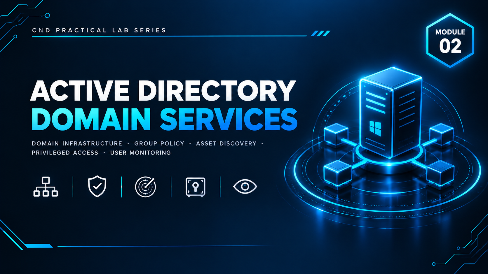

  

<h1>Module 02 — Active Directory Infrastructure &amp; Administrative Security Controls</h1>
<h3>Enterprise Domain Build-Out with GPO Hardening, Asset Discovery, PAM &amp; Insider Threat Monitoring</h3>

 

  

<a href="#lab-topology"><b>Topology</b></a> &nbsp;·&nbsp;
<a href="#implementation-phases"><b>Phases</b></a> &nbsp;·&nbsp;
<a href="#group-policy-baseline"><b>GPO Baseline</b></a> &nbsp;·&nbsp;
<a href="#key-takeaways"><b>Takeaways</b></a> &nbsp;·&nbsp;
<a href="#full-report"><b>Full Report</b></a>

 

---

## Executive Summary

This module demonstrates the implementation of core **administrative network security controls** within a virtualized enterprise domain. Using VMware Workstation as the hypervisor, a three-machine domain infrastructure was built — a Windows Server 2019 Domain Controller (**DC01**), an administrative workstation (**ADM01**), and a client workstation (**CLI01**) — all operating within an isolated host-only network under the domain **`crack.local`**.

The lab was structured across five implementation phases: Active Directory organizational design, a Group Policy security baseline, network asset discovery, privileged access management, and endpoint activity monitoring — reflecting a layered administrative security approach combining identity management, policy enforcement, asset visibility, credential protection, and behavioral monitoring.

> All testing was performed in a fully isolated host-only virtual network with no internet exposure to the domain segment. All credentials shown are disposable lab-only values.

 

## Lab Topology

<table>
<tr><th>VM</th><th>Operating System</th><th>Role</th><th>Internal IP</th></tr>
<tr><td><b>DC01</b></td><td>Windows Server 2019</td><td>Domain Controller, DNS, AD DS, Lansweeper, PAM360</td><td><code>192.168.100.100</code></td></tr>
<tr><td><b>ADM01</b></td><td>Windows 10 x64</td><td>Administrative workstation, SpyAgent deployment</td><td><code>192.168.100.110</code></td></tr>
<tr><td><b>CLI01</b></td><td>Windows 10 (cloned)</td><td>Standard domain client</td><td><code>192.168.100.120</code></td></tr>
</table>

**Virtual Networks**

| VMnet | Type | Subnet | Purpose |
|---|---|---|---|
| VMnet3 | Host-Only | `192.168.100.0/24` | Internal domain network — DHCP disabled, static IPs only |
| VMnet2 | NAT | `192.168.200.0/24` | Internet access for the domain controller — DHCP enabled |

**Domain Configuration**

| Property | Value |
|---|---|
| Domain Name | `crack.local` |
| NetBIOS Name | `CRACK` |
| Forest / Domain Functional Level | Windows Server 2016 |
| Domain Controller | `DC01.crack.local` |

 

## Implementation Phases

<table>
<tr><th>Phase</th><th>Focus</th><th>Outcome</th></tr>
<tr><td><b>1 — Active Directory Structure</b></td><td>Departmental OUs (<code>IT</code>, <code>Finance</code>, <code>HR</code>, <code>Servers</code>, <code>Workstations</code>) and role-based accounts</td><td>Least-privilege organizational design; <code>it.admin</code> explicitly added to Domain Admins while HR/Finance accounts remain standard users</td></tr>
<tr><td><b>2 — Security Baseline (GPO)</b></td><td>Domain-wide password complexity, account lockout, audit logging</td><td>Verified via Event Viewer (Event IDs <code>4624</code>/<code>4625</code>) and <code>rsop.msc</code></td></tr>
<tr><td><b>3 — Asset Discovery</b></td><td>Network-wide scan with <code>Lansweeper</code></td><td>All domain-joined devices identified across <code>192.168.100.0/24</code></td></tr>
<tr><td><b>4 — Privileged Access Management</b></td><td><code>ManageEngine PAM360</code> credential vaulting</td><td>Domain admin credentials for DC01 centralized in an encrypted vault with RDP session recording enabled</td></tr>
<tr><td><b>5 — Insider Threat Monitoring</b></td><td><code>SpyAgent</code> deployed on CLI01</td><td>Keystrokes, program usage, and website activity captured and verified against controlled test actions</td></tr>
</table>

 

## Group Policy Baseline

**Password Policy** *(Default Domain Policy)*

| Setting | Value |
|---|---|
| Enforce password history | 10 passwords |
| Maximum password age | 90 days |
| Minimum password age | 1 day |
| Minimum password length | 7 characters |
| Complexity requirements | Enabled |
| Reversible encryption | Disabled |

**Account Lockout Policy**

| Setting | Value |
|---|---|
| Lockout threshold | 5 invalid logon attempts |
| Lockout duration | 5 minutes |
| Reset counter after | 5 minutes |
| Administrator account lockout | Enabled |

**Audit Policy**

- Account logon events — Success, Failure
- Logon events — Success, Failure
- Account management — Success
- Object access — Success
- Policy change — Success

Lockout enforcement was functionally validated by deliberately failing login five times on the `hr.user` account from a domain client, confirming the account lock and the subsequent unlock workflow through Active Directory Users and Computers.

 

## Identity &amp; Access Structure

| Organizational Unit | Purpose |
|---|---|
| `IT` | IT administrator accounts |
| `Finance` | Finance department users |
| `HR` | Human Resources users |
| `Servers` | Server computer objects |
| `Workstations` | Client computer objects |

| Account | OU | Privilege Level |
|---|---|---|
| `CRACK\it.admin` | IT | Domain Admin (explicitly granted via Member Of) |
| `CRACK\hr.user` | HR | Standard domain user |
| `CRACK\fin.user` | Finance | Standard domain user |

 

## Tooling Deployed

<table>
<tr><td><b>Lansweeper v12.6.3.5</b></td><td>Network asset discovery — auto-scans <code>192.168.100.0/24</code>, identifies all domain-joined devices via administrative scanning credentials</td></tr>
<tr><td><b>ManageEngine PAM360</b></td><td>Privileged Access Management — encrypted credential vault for DC01's domain admin account, with mandatory RDP session recording</td></tr>
<tr><td><b>SpyAgent (Spytech)</b></td><td>Endpoint activity monitoring — keystroke logging, program usage tracking, and web/search activity capture for insider threat detection</td></tr>
</table>

 

## Key Takeaways

- **Least privilege by design:** separating users into department-specific OUs and granting Domain Admin rights only to `it.admin` enforces role-based access control at the directory level.
- **Policy enforcement must be verified, not assumed** — `gpupdate /force` and `rsop.msc` were used to confirm GPOs actually applied before relying on them, and lockout behavior was functionally tested rather than just configured.
- **Visibility precedes control:** asset discovery via Lansweeper established a baseline inventory of every domain-joined device before access or monitoring controls were layered on top.
- **Credential sprawl is a real risk** — centralizing privileged credentials in PAM360 with session recording removes the need for admins to handle or share raw passwords.
- **Insider threat monitoring tools like SpyAgent are powerful but sensitive** — they must be deployed only within applicable legal and organizational disclosure requirements.

 

## Lab Environment

| | |
|---|---|
| **Hypervisor** | VMware Workstation |
| **Networking** | VMnet3 (Host-Only, domain) + VMnet2 (NAT, internet) |
| **Tools Used** | `Active Directory Domain Services` `Group Policy Management` `Lansweeper` `ManageEngine PAM360` `SpyAgent` |
| **Scope** | Isolated lab only — zero production exposure |

 

## Full Report

The complete 87-page report — including every installation screen, GPO configuration step, Lansweeper scan result, PAM360 vault setup, and SpyAgent monitoring log — is available here:

📄 **[NS-M2.pdf](./NS-M2.pdf)**

 

## Disclaimer

This lab was conducted in a private, isolated virtual environment built solely for educational purposes under the EC-Council CND curriculum. No real production systems, networks, or employees were monitored or affected. All credentials, domain names, and IP addresses shown are lab-only values with no validity outside this sandbox.

 

⬅ <a href="../"><b>Back to Main Repository</b></a>

