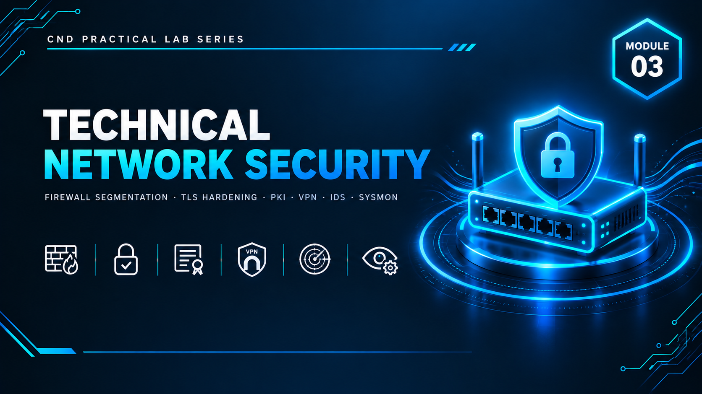

  

<h1>Module 03 — Technical Network Security</h1>
<h3>Protocol Hardening, Enterprise PKI, VPN, Intrusion Detection &amp; Enhanced Logging</h3>

 

  

<a href="#lab-topology"><b>Topology</b></a> &nbsp;·&nbsp;
<a href="#controls-implemented"><b>Controls</b></a> &nbsp;·&nbsp;
<a href="#attack-validation"><b>Attack Validation</b></a> &nbsp;·&nbsp;
<a href="#key-takeaways"><b>Takeaways</b></a> &nbsp;·&nbsp;
<a href="#full-report"><b>Full Report</b></a>

 

---

## Executive Summary

Module 3 builds directly on the Active Directory environment (`crack.local`) established in **[Module 2](../M02-AdministrativeNetworkSecurity/)**, extending it with technical network security controls. Three new virtual machines were introduced — **VPN01**, **IDS01**, and **ATTACK01** — to deliver network segmentation, protocol hardening, TLS enforcement, an enterprise Certificate Authority, a site-accessible VPN, an intrusion detection system, and enhanced endpoint logging.

Every control was validated through live, controlled attacks launched from ATTACK01: reconnaissance, an EternalBlue/SMBv1 exposure check, brute-force lockout testing, LLMNR poisoning, VPN access testing, and TLS version verification — confirming each hardening measure actually holds under attack rather than just being configured.

> All testing was performed in a fully isolated host-only virtual network with no connection to production systems. All credentials, pre-shared keys, and IP addresses shown are disposable lab-only values.

 

## Lab Topology

<table>
<tr><th>VM</th><th>IP Address</th><th>Operating System</th><th>Role</th></tr>
<tr><td>DC01</td><td><code>192.168.100.100</code></td><td>Windows Server 2019</td><td>Domain Controller — carried over from Module 2</td></tr>
<tr><td>ADMIN01</td><td><code>192.168.100.110</code></td><td>Windows 10 Pro</td><td>Management workstation — carried over from Module 2</td></tr>
<tr><td>CL01</td><td><code>192.168.100.120</code></td><td>Windows 10 Pro</td><td>Client workstation — carried over from Module 2</td></tr>
<tr><td><b>VPN01</b></td><td><code>192.168.100.130</code></td><td>Windows Server 2019</td><td>VPN server — new in Module 3</td></tr>
<tr><td><b>IDS01</b></td><td><code>192.168.100.140</code></td><td>Kali Linux</td><td>Intrusion detection sensor — new in Module 3</td></tr>
<tr><td><b>ATTACK01</b></td><td><code>192.168.100.150</code></td><td>Kali Linux</td><td>Attack simulation machine — new in Module 3</td></tr>
</table>

All machines operate on the domain `crack.local`, internal network `192.168.100.0/24`, inherited from Module 2.

 

## Controls Implemented

<table>
<tr><th>Control</th><th>Implementation</th></tr>
<tr><td><b>Network Segmentation</b></td><td>Windows Firewall rules on DC01 — blocked ICMP and RDP from CL01, explicitly allowed AD services from internal hosts, firewall logging enabled and segmentation verified</td></tr>
<tr><td><b>Insecure Protocol Removal</b></td><td>SMBv1 disabled (SMBv2/v3 retained), LLMNR disabled via GPO, NetBIOS and mDNS disabled via registry, Telnet replaced with SSH</td></tr>
<tr><td><b>TLS Hardening</b></td><td>TLS 1.2 enforced domain-wide; TLS 1.0/1.1 and weak ciphers blocked</td></tr>
<tr><td><b>Enterprise PKI</b></td><td>AD Certificate Services deployed on DC01 as an Enterprise Root CA (<code>CRACK-Root-CA</code>, RSA 4096-bit, SHA-256, 10-year validity), with certificate auto-enrollment enabled via GPO</td></tr>
<tr><td><b>VPN Access</b></td><td>SoftEther VPN Server on VPN01 — L2TP/IPsec hub (<code>CORP-VPN</code>) with SecureNAT/DHCP for remote clients</td></tr>
<tr><td><b>Intrusion Detection</b></td><td>Suricata IDS deployed on IDS01 with updated rule sets, custom local detection rules, and a live alert monitor</td></tr>
<tr><td><b>Enhanced Logging</b></td><td>Sysmon installed on DC01 and ADMIN01, verified through Event Viewer</td></tr>
<tr><td><b>Secure Remote Management</b></td><td>Windows Admin Center deployed for encrypted (HTTPS/6516), logged remote administration of DC01</td></tr>
</table>

 

## PKI Configuration

| Property | Value |
|---|---|
| CA Type | Enterprise Root CA |
| CA Name | `CRACK-Root-CA` |
| Cryptographic Provider | RSA#Microsoft Software Key Storage Provider |
| Key Length | 4096-bit |
| Hash Algorithm | SHA-256 |
| Validity Period | 10 years |
| Auto-Enrollment | Enabled via Default Domain Policy (Public Key Policies) |

## VPN Configuration

| Property | Value |
|---|---|
| Platform | SoftEther VPN Server |
| Protocol | L2TP over IPsec |
| Virtual Hub | `CORP-VPN` |
| Client Addressing | SecureNAT (Virtual DHCP) |
| VPN Azure Cloud | Disabled (on-premises only) |

 

## Attack Validation

Every control above was tested against a live attack from ATTACK01, with Suricata alerts monitored in real time on IDS01.

<table>
<tr><th>#</th><th>Attack</th><th>Target Control</th><th>Result</th></tr>
<tr><td>1</td><td>Network reconnaissance (<code>nmap -sn</code>, <code>-sS</code>, <code>-A</code>)</td><td>IDS detection</td><td>All domain hosts discovered; Suricata generated alerts for the scan in real time</td></tr>
<tr><td>2</td><td>SMBv1 / EternalBlue check (<code>smb-protocols</code>, <code>smb-vuln-ms17-010</code>)</td><td>Protocol hardening</td><td>SMBv1 not present; no EternalBlue vulnerability reported — confirmed the SMBv1 disable was effective</td></tr>
<tr><td>3</td><td>Brute-force attack against SMB (<code>hydra</code> vs <code>hr.user</code>)</td><td>Module 2 account lockout GPO</td><td>Account locked after 5 failed attempts; Hydra could not recover a valid password</td></tr>
<tr><td>4</td><td>LLMNR poisoning (<code>responder</code>)</td><td>LLMNR/NetBIOS/mDNS hardening</td><td>No NTLM hash captured once NetBIOS and mDNS were disabled on the client — confirming the mitigation works only where applied</td></tr>
<tr><td>5</td><td>VPN access attempt (L2TP/IPsec client connection)</td><td>VPN authentication</td><td>Successful connection with valid credentials and the correct pre-shared key; internal network reachable through the tunnel</td></tr>
<tr><td>6</td><td>TLS cipher enumeration (<code>ssl-enum-ciphers</code>)</td><td>TLS hardening</td><td>Only TLS 1.2 offered; TLS 1.0 and TLS 1.1 completely unavailable</td></tr>
</table>

 

## Key Takeaways

- **One unprotected endpoint breaks the model.** During the LLMNR poisoning test, Responder successfully captured credential hashes from CL01 — not because DC01 was weak, but because NetBIOS/mDNS hardening hadn't yet been applied to that specific client. Hardening must be consistent across every machine, not just the server.
- **Administrative and technical controls are interdependent.** The account lockout policy configured via GPO in Module 2 is what stopped the Hydra brute-force attack in Module 3 — neither layer is effective alone.
- **Verification beats assumption.** Every control — SMBv1 removal, TLS version restriction, lockout enforcement — was proven using the attacker's own tools (Nmap, Hydra, Responder) rather than just confirmed in a settings panel.
- **Defense in depth, applied practically:** segmentation (firewall), encryption in transit (TLS/PKI), encrypted remote access (VPN), detection (Suricata), and visibility (Sysmon) were layered together rather than relied on individually.

 

## Lab Environment

| | |
|---|---|
| **Hypervisor** | VMware Workstation |
| **Prerequisite** | Module 2 (Active Directory) fully deployed |
| **Networking** | `192.168.100.0/24`, domain `crack.local` |
| **Tools Used** | `AD CS` `SoftEther VPN` `Suricata` `Sysmon` `Windows Admin Center` `Nmap` `Hydra` `Responder` |
| **Scope** | Isolated lab only — zero production exposure |

 

## Full Report

The complete 115-page report — including every VM build step, PKI and VPN configuration screen, Suricata rule set, and full attack-by-attack validation log — is available here:

📄 **[NS-M3.pdf](./NS-M3.pdf)**

 

## Disclaimer

This lab was conducted in a private, isolated virtual environment built solely for educational purposes under the EC-Council CND curriculum. No real production systems, networks, or live targets were accessed or affected. All credentials, pre-shared keys, and IP addresses shown are lab-only values with no validity outside this sandbox.

 

⬅ <a href="../"><b>Back to Main Repository</b></a>

