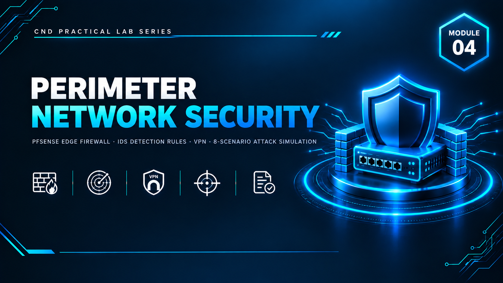

  

<h1>Module 04 — Perimeter Network Security</h1>
<h3>pfSense Edge Firewall Deployment &amp; 8-Scenario Defense-in-Depth Validation</h3>

 

  

<a href="#lab-topology"><b>Topology</b></a> &nbsp;·&nbsp;
<a href="#perimeter-controls"><b>Perimeter Controls</b></a> &nbsp;·&nbsp;
<a href="#attack-simulation"><b>Attack Simulation</b></a> &nbsp;·&nbsp;
<a href="#key-takeaways"><b>Takeaways</b></a> &nbsp;·&nbsp;
<a href="#full-report"><b>Full Report</b></a>

 

---

## Executive Summary

Module 4 completes a three-part lab series by adding a **perimeter security layer** to the environment built in **[Module 2](../M02-Administrative%20Network%20Security/)** and **[Module 3](../M03-Technical%20Network%20Security/)**. **pfSense** is deployed as the edge firewall and default gateway for every virtual machine, replacing previously unconfigured gateways so that all network traffic is subject to centrally enforced firewall rules.

Firewall rules were configured to block ICMP and RDP from the client workstation to the domain controller while explicitly permitting essential Active Directory services. Suricata on IDS01 was extended with new detection rules covering SQL injection, XSS, brute force, and LLMNR poisoning, and the SoftEther VPN on VPN01 was validated to continue functioning correctly through the new gateway. An **eight-scenario attack simulation** from ATTACK01 confirmed every control holds: firewall rules block restricted traffic, the IDS detects application-layer attacks, account lockout stops brute force, and LLMNR poisoning fails thanks to the Module 3 GPO.

> All testing was performed in a fully isolated host-only / NAT virtual network with no connection to production systems. All credentials, pre-shared keys, and IP addresses shown are disposable lab-only values.

 

## Lab Topology

Module 4 re-addresses the network under `192.168.10.0/24`, routed centrally through pfSense:

<table>
<tr><th>Device</th><th>IP Address</th><th>Role</th></tr>
<tr><td>pfSense (LAN)</td><td><code>192.168.10.4</code></td><td>Edge firewall / default gateway for all VMs</td></tr>
<tr><td>DC01</td><td><code>192.168.10.10</code></td><td>Domain Controller</td></tr>
<tr><td>ADMIN01</td><td><code>192.168.10.20</code></td><td>Management workstation</td></tr>
<tr><td>CL01</td><td><code>192.168.10.30</code></td><td>Client workstation</td></tr>
<tr><td>VPN01</td><td><code>192.168.10.50</code></td><td>SoftEther VPN server</td></tr>
<tr><td>IDS01</td><td><code>192.168.10.60</code></td><td>Suricata IDS sensor</td></tr>
<tr><td>ATTACK01</td><td>DHCP (NAT)</td><td>Attack simulation machine</td></tr>
</table>

| VMnet | Type | Subnet | Purpose |
|---|---|---|---|
| VMnet1 | Host-Only | `192.168.10.0/24` | Internal LAN — DHCP disabled, static IPs, routed via pfSense |
| VMnet8 | NAT | `192.168.1.0/24` | WAN — internet access for pfSense, VPN01, and ATTACK01 |

 

## Perimeter Controls

<table>
<tr><th>Control</th><th>Implementation</th></tr>
<tr><td><b>Gateway Centralization</b></td><td>Every VM (ADMIN01, DC01, CL01, VPN01, IDS01, ATTACK01) repointed to <code>192.168.10.4</code> as its default gateway — the single most critical step, without which firewall rules cannot take effect</td></tr>
<tr><td><b>Firewall Rule 1</b></td><td>Block ICMP (ping) from CL01</td></tr>
<tr><td><b>Firewall Rule 2</b></td><td>Block RDP from CL01 to DC01</td></tr>
<tr><td><b>Firewall Rule 3</b></td><td>Allow essential Active Directory services from the internal network to DC01</td></tr>
<tr><td><b>Logging</b></td><td>Logging enabled on all firewall rules for later correlation during the attack simulation</td></tr>
<tr><td><b>VPN Pass-Through Rule</b></td><td>Explicit pfSense rule permitting VPN client traffic from VPN01 to the LAN</td></tr>
<tr><td><b>Suricata Rule Expansion</b></td><td>New detection signatures added for SQL injection, XSS, brute force, and LLMNR/NBT-NS poisoning</td></tr>
</table>

After the gateway migration, every control from Modules 2 and 3 was explicitly re-verified: AD OUs/users/group memberships, GPO application via `gpupdate /force`, SMBv1 remaining disabled, account lockout policy still active, TLS 1.0 still disabled, and LLMNR still disabled — confirming the perimeter change didn't silently break prior hardening.

 

## Attack Simulation

All eight scenarios were run from ATTACK01 while watching Suricata alerts (`tail -f /var/log/suricata/fast.log`) on IDS01 and the pfSense firewall log simultaneously.

<table>
<tr><th>#</th><th>Attack</th><th>Expected Control Behavior</th><th>Result</th></tr>
<tr><td>1</td><td>Network reconnaissance (<code>nmap -A -T5</code>, <code>-sS</code>, UDP scan of VPN ports)</td><td>IDS detects scan activity</td><td>Suricata alerted on the port scan; VPN UDP ports (500, 1701, 4500) identified</td></tr>
<tr><td>2</td><td>SMBv1 / EternalBlue check (<code>smb-protocols</code>, <code>smb-vuln-ms17-010</code>)</td><td>Should fail — SMBv1 hardening from Module 3</td><td>SMBv1 not present; no EternalBlue vulnerability found</td></tr>
<tr><td>3</td><td>Hydra brute force against <code>hr.user</code> over SMB</td><td>Account lockout after 5 attempts</td><td>Account locked; Hydra could not recover valid credentials</td></tr>
<tr><td>4</td><td>LLMNR poisoning (<code>responder</code> + forced lookup on CL01)</td><td>Should fail — LLMNR disabled via Module 3 GPO</td><td>No hashes captured by Responder</td></tr>
<tr><td>5</td><td>SQL injection against <code>Login.aspx</code> (boolean &amp; UNION-based payloads via <code>curl</code>)</td><td>IDS detects application-layer attack</td><td>Suricata alerted on the SQL injection signatures</td></tr>
<tr><td>6</td><td>XSS payloads against <code>Comments.aspx</code></td><td>IDS detects application-layer attack</td><td>Suricata alerted on the XSS signatures</td></tr>
<tr><td>7</td><td>VPN access validation — correct and incorrect credentials</td><td>Valid creds succeed, invalid creds fail and are logged</td><td>Valid login established a tunnel with a routable internal IP; invalid login failed and was recorded in the SoftEther server log</td></tr>
<tr><td>8</td><td>TLS version verification on LDAPS (636) and RDP (3389)</td><td>Only TLS 1.2 available</td><td>Confirmed — TLS 1.0/1.1 absent on both ports</td></tr>
</table>

 

## Monitoring &amp; Logging Verification

- **Sysmon** confirmed running (`Get-Service sysmon64`) on DC01, with logs visible in Event Viewer.
- **Windows Admin Center** (`https://localhost:6516`) confirmed live CPU/RAM overview, loading Security event logs, and functional remote PowerShell access to DC01.
- **pfSense firewall logs** reviewed during the attack simulation (switched to dynamic view due to log volume).
- **Suricata/IDS logs** confirmed alerts for brute force attempts, TCP port scans, ET-category signatures, and NBT-NS queries.

 

## Key Takeaways

- **Perimeter security is not a replacement for host-based controls — it's an additional layer.** The firewall blocks what shouldn't reach the LAN; Suricata detects what makes it through; GPO-enforced account lockout stops credential attacks at the endpoint.
- **A gateway migration can silently break prior hardening if not re-verified.** Every Module 2/3 control (lockout, SMBv1, TLS, LLMNR) was explicitly re-tested after repointing every VM to the new pfSense gateway, rather than assumed to still be working.
- **Centralized logging enables correlation.** Watching the pfSense firewall log and the Suricata alert feed side-by-side during the attack simulation made it possible to see each attack blocked, detected, or rejected across multiple layers simultaneously.
- **Defense in depth, demonstrated end-to-end:** across Modules 2–4, administrative hardening (AD/GPO), technical hardening (protocols/TLS/PKI/VPN/IDS), and perimeter enforcement (pfSense) were shown working together, with each layer's failure mode covered by another.

 

## Lab Environment

| | |
|---|---|
| **Hypervisor** | VMware Workstation |
| **Prerequisite** | Modules 2 and 3 fully deployed |
| **Networking** | VMnet1 (Host-Only LAN, `192.168.10.0/24`) + VMnet8 (NAT WAN) |
| **Tools Used** | `pfSense` `Suricata` `Nmap` `Hydra` `Responder` `curl` |
| **Scope** | Isolated lab only — zero production exposure |

 

## Full Report

The complete 58-page report — including every pfSense configuration screen, gateway migration step, firewall rule, and all eight attack scenarios with corresponding IDS/firewall log evidence — is available here:

📄 **[NS-M4.pdf](./NS-M4.pdf)**

 

## Disclaimer

This lab was conducted in a private, isolated virtual environment built solely for educational purposes under the EC-Council CND curriculum. No real production systems, networks, or live targets were accessed or affected. All credentials, pre-shared keys, and IP addresses shown are lab-only values with no validity outside this sandbox.

 

⬅ <a href="../"><b>Back to Main Repository</b></a>

