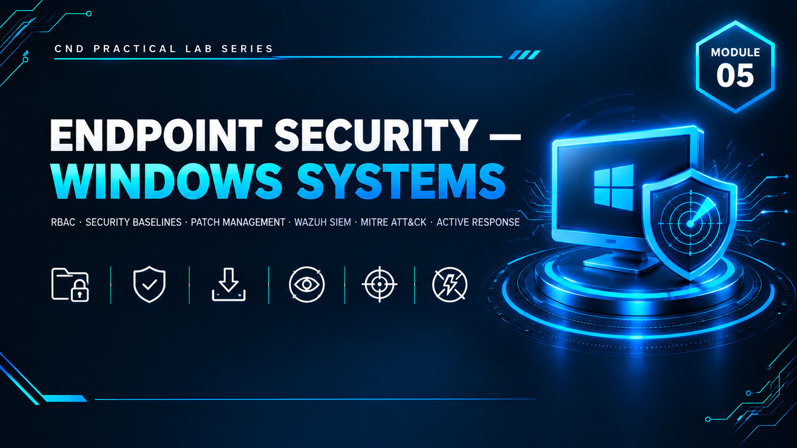

  

<h1>Module 05 — Endpoint Security for Windows Systems</h1>
<h3>RBAC, Security Baselines, Patch Management, Wazuh SIEM &amp; Automated Active Response</h3>

 

  

<a href="#lab-topology"><b>Topology</b></a> &nbsp;·&nbsp;
<a href="#controls-implemented"><b>Controls</b></a> &nbsp;·&nbsp;
<a href="#mitre-attck-detection-mapping"><b>MITRE Mapping</b></a> &nbsp;·&nbsp;
<a href="#attack-simulation"><b>Attack Simulation</b></a> &nbsp;·&nbsp;
<a href="#key-takeaways"><b>Takeaways</b></a> &nbsp;·&nbsp;
<a href="#full-report"><b>Full Report</b></a>

 

---

## Executive Summary

Module 5 focuses on **Endpoint Security for Windows Systems** and completes the defensive lifecycle on the existing lab domain (`corp.local`) carried forward from Modules 2–4. Two new virtual machines were introduced — **SRV01** (Windows Server 2019 file/patch server) and **CL02** (an unauthorized-user Windows 10 client used specifically to test access control failures) — while **IDS01 was upgraded to host the Wazuh SIEM**.

The module implements Role-Based Access Control on a sensitive file share, applies Microsoft's official security baselines, centralizes patch management, hardens Windows authentication and auditing, deploys a full SIEM with custom MITRE-mapped detection rules, and configures automated active response to block attackers in real time — demonstrating an end-to-end cycle of **prevention, detection, and automated response**.

> All testing was performed in a fully isolated virtual network with no connection to production systems. All credentials and IP addresses shown are disposable lab-only values.

 

## Lab Topology

<table>
<tr><th>VM</th><th>IP Address</th><th>OS</th><th>Role</th></tr>
<tr><td>DC01</td><td><code>192.168.10.10</code></td><td>Windows Server 2019</td><td>Domain Controller (existing)</td></tr>
<tr><td>ADMIN01</td><td><code>192.168.10.20</code></td><td>Windows 10</td><td>Management workstation (existing)</td></tr>
<tr><td>CL01</td><td><code>192.168.10.30</code></td><td>Windows 10</td><td>Client workstation (existing)</td></tr>
<tr><td>VPN01</td><td><code>192.168.10.50</code></td><td>Windows Server</td><td>VPN server (existing)</td></tr>
<tr><td>IDS01</td><td><code>192.168.10.60</code></td><td>Kali/Ubuntu</td><td>Upgraded to host the <b>Wazuh SIEM</b></td></tr>
<tr><td>ATTACKER</td><td><code>192.168.10.40</code></td><td>Kali Linux</td><td>Attack simulation machine (existing)</td></tr>
<tr><td><b>SRV01</b></td><td><code>192.168.10.25</code></td><td>Windows Server 2019</td><td><b>New</b> — Patch management &amp; secure file server</td></tr>
<tr><td><b>CL02</b></td><td><code>192.168.10.102</code></td><td>Windows 10</td><td><b>New</b> — Unauthorized-user test client</td></tr>
</table>

 

## Controls Implemented

<table>
<tr><th>Phase</th><th>Control</th><th>Detail</th></tr>
<tr><td>1–2</td><td>RBAC Identity Design</td><td>Finance OU built with role-based accounts: <code>bob</code> and <code>john</code> (authorized finance users, added to a <code>FinanceData</code> security group), <code>martin</code> (deliberately unauthorized), and <code>alice</code> (general client user)</td></tr>
<tr><td>3</td><td>Secure File Sharing (RBAC)</td><td><code>FinanceData</code> share on SRV01 — least-privilege Share and NTFS permissions aligned to the security group, Access-Based Enumeration enabled so unauthorized users can't even see the share, then explicitly access-tested as <code>martin</code> from CL02 to confirm denial</td></tr>
<tr><td>4</td><td>Security Baselines</td><td>Microsoft Security Compliance Toolkit (MSCT) deployed on DC01; Policy Analyzer run to flag deviations; baselines applied via <code>LGPO</code> on both DC01 and SRV01</td></tr>
<tr><td>5</td><td>Patch Management</td><td><code>BatchPatch</code> installed on SRV01 for centralized remote scanning and patch deployment across domain machines</td></tr>
<tr><td>6</td><td>Advanced Hardening</td><td>NTLM authentication disabled, Windows Firewall rules enabled (including a dedicated rule protecting the file share on SRV01), advanced audit policies enabled</td></tr>
<tr><td>7–8</td><td>SIEM Deployment</td><td><code>Wazuh</code> server installed on IDS01; agents connected from domain endpoints; <code>Sysmon</code> integrated for enhanced telemetry; custom log collection and detection rules configured</td></tr>
<tr><td>9</td><td>MITRE ATT&amp;CK Mapping</td><td>Every custom Wazuh rule tagged to a MITRE technique, visualized live in the Wazuh ATT&amp;CK matrix</td></tr>
<tr><td>10</td><td>Attack Simulation</td><td>Reconnaissance, SMB enumeration, brute force, and CrackMapExec credential attacks run from the ATTACKER machine</td></tr>
<tr><td>11</td><td>Active Response</td><td>Wazuh configured to automatically fire <code>firewall-drop</code> and block an attacking IP in real time upon rule trigger</td></tr>
</table>

 

## MITRE ATT&amp;CK Detection Mapping

Custom Wazuh rules were written and mapped directly to MITRE techniques and tactics:

<table>
<tr><th>Detection</th><th>MITRE Technique</th><th>Tactic</th></tr>
<tr><td>Single failed login</td><td>T1110 — Brute Force</td><td>Credential Access</td></tr>
<tr><td>Repeated failed logins (threshold)</td><td>T1110 — Brute Force</td><td>Credential Access</td></tr>
<tr><td>SMB access attempt</td><td>T1021.002 — SMB/Windows Admin Shares</td><td>Lateral Movement</td></tr>
<tr><td>CrackMapExec SMB activity</td><td>T1021.002 — SMB/Windows Admin Shares</td><td>Lateral Movement</td></tr>
<tr><td>Suspicious PowerShell execution</td><td>T1059.001 — PowerShell</td><td>Execution</td></tr>
<tr><td>PowerShell download cradle</td><td>T1059.001 — PowerShell</td><td>Execution</td></tr>
<tr><td>Network scan activity</td><td>T1046 — Network Service Scanning</td><td>Discovery</td></tr>
<tr><td>Account lockout event</td><td>T1110 — Brute Force</td><td>Credential Access</td></tr>
<tr><td>New AD user created</td><td>T1136.002 — Domain Account</td><td>Persistence</td></tr>
<tr><td>Admin group membership change</td><td>T1098 — Account Manipulation</td><td>Persistence</td></tr>
</table>

Wazuh's ATT&CK matrix view was used to confirm these techniques visually "light up" as the corresponding attacks were executed.

 

## Attack Simulation

All attacks launched from ATTACKER (`192.168.10.40`), monitored live via Wazuh Security Events (filtered by agent).

<table>
<tr><th>#</th><th>Attack</th><th>MITRE ID</th><th>Observed Result</th></tr>
<tr><td>1</td><td>Network reconnaissance — host discovery, service/version/OS detection, full port scan</td><td>T1046</td><td>Scan alerts triggered in Wazuh within 1–2 minutes of the scan starting</td></tr>
<tr><td>2</td><td>SMB enumeration — share/user enumeration via Nmap and CrackMapExec</td><td>T1021.002</td><td><code>FinanceData</code> share not accessible anonymously; enumeration activity logged by both Suricata and Wazuh</td></tr>
<tr><td>3</td><td>Hydra and CrackMapExec brute force against <code>martin</code> over SMB</td><td>T1110</td><td>Account locked after 5 attempts (Module 2 GPO); Wazuh rule <code>100008</code> fired; Event IDs <code>4625</code> (failed logon) and <code>4740</code> (account locked) recorded on DC01</td></tr>
<tr><td>4</td><td>CrackMapExec password spray and credentialed share/session enumeration</td><td>T1110 / T1021.002</td><td>Advanced credential-attack activity captured for SIEM correlation</td></tr>
</table>

 

## Active Response Configuration

Wazuh's Active Response module was configured on IDS01 to automatically block an attacking IP using the built-in `firewall-drop` command:

| Rule ID(s) | Trigger | Scope | Block Duration |
|---|---|---|---|
| `100001`, `100002`, `100004` | Brute-force detection rules | `local` (Wazuh server) | 600 seconds (10 minutes) |
| `100004` | Severe SMB attack | `all` (all connected agents) | 3600 seconds (1 hour) |

This closes the loop from **detection → automated response** without requiring manual analyst intervention for known attack patterns.

 

## Key Takeaways

- **Least privilege must be enforced, not assumed.** `martin`'s account exists specifically to prove that Share + NTFS permissions and Access-Based Enumeration correctly deny an unauthorized user — tested directly from CL02 rather than just configured.
- **Baselines catch what manual hardening misses.** Running the Microsoft Security Compliance Toolkit's Policy Analyzer against DC01 surfaced configuration drift that wasn't otherwise visible.
- **Detection needs structure, not just alerts.** Mapping every custom Wazuh rule to a specific MITRE ATT&CK technique and tactic turns raw log noise into a structured, auditable threat-coverage model.
- **Response can — and should — be automated for known patterns.** Active Response closes the gap between "an alert fired" and "the attacker is blocked," without waiting on a human in the loop.
- **Endpoint security is a full lifecycle:** identity/access design → baseline hardening → patch currency → visibility (SIEM) → detection (MITRE-mapped rules) → automated response, each phase building on the last.

 

## Lab Environment

| | |
|---|---|
| **Hypervisor** | VMware Workstation |
| **Prerequisite** | Modules 2–4 fully deployed |
| **Networking** | `192.168.10.0/24`, domain `corp.local` |
| **Tools Used** | `Wazuh` `Sysmon` `BatchPatch` `LGPO` `Microsoft Security Compliance Toolkit` `CrackMapExec` `Hydra` `Nmap` |
| **Scope** | Isolated lab only — zero production exposure |

 

## Full Report

The complete 35-page report — including every RBAC permission screen, LGPO baseline application, BatchPatch configuration, full Wazuh deployment, custom detection rule XML, and attack-by-attack SIEM evidence — is available here:

📄 **[NS-M5.pdf](./NS-M5.pdf)**

 

## Disclaimer

This lab was conducted in a private, isolated virtual environment built solely for educational purposes under the EC-Council CND curriculum. No real production systems, networks, or live targets were accessed or affected. All credentials and IP addresses shown are lab-only values with no validity outside this sandbox.

 

⬅ <a href="../"><b>Back to Main Repository</b></a>

