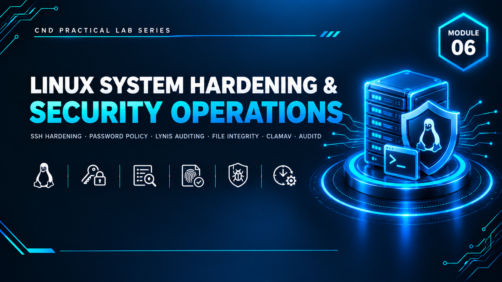

  

<h1>Module 06 — Linux System Hardening &amp; Security Operations</h1>
<h3>Automated Monitoring, Auditing &amp; Maintenance Across 7 Hardening Labs</h3>

 

  

<a href="#lab-topology"><b>Topology</b></a> &nbsp;·&nbsp;
<a href="#hardening-labs"><b>7 Labs</b></a> &nbsp;·&nbsp;
<a href="#automation--scheduling"><b>Automation</b></a> &nbsp;·&nbsp;
<a href="#key-takeaways"><b>Takeaways</b></a> &nbsp;·&nbsp;
<a href="#full-report"><b>Full Report</b></a>

 

---

## Executive Summary

Module 6 focuses on **Linux System Hardening & Security Operations**. It builds a segmented lab network protected by a **Smoothwall** firewall (GREEN internal / RED external) and applies layered, progressive hardening controls to an Ubuntu "Operation Dept" VM across seven structured labs — covering SSH and access hardening, password policy enforcement, security auditing, file integrity monitoring, malware detection, kernel-level event auditing, and system cleanup.

Every major control was converted into a **reusable script and scheduled via cron** (daily integrity/audit checks, weekly malware scans and cleanup), reflecting real-world security operations practice where hardening is a continuous process rather than a one-time configuration pass. The result is a measurably more secure environment, validated by a Lynis hardening index improvement from **68 to 69** across the lab.

> All testing was performed in a fully isolated host-only / NAT virtual network with no connection to production systems.

 

## Lab Topology

| VMnet | Type | Subnet | Purpose |
|---|---|---|---|
| VMnet1 | Host-Only | `192.168.10.0/24` | GREEN (internal) network — no DHCP |
| VMnet3 | NAT | `192.168.100.0/24` | RED (external) network — DHCP enabled |

**Smoothwall Firewall** — two network adapters, one per VMnet, configured as GREEN + RED segmentation (Smoothwall Express 3.1).

**Ubuntu "Operation Dept" VM** — static IP configured via Netplan, connectivity verified to the Smoothwall gateway and the domain controller (DC01) from prior modules.

 

## Hardening Labs

<table>
<tr><th>Lab</th><th>Focus</th><th>Key Actions</th></tr>
<tr><td><b>1 — Linux Security Best Practices</b></td><td>Service &amp; access hardening</td><td>Disabled unnecessary services (Apache2, avahi-daemon); hardened SSH (restricted root login, disabled X11 forwarding); created a dedicated user/group; configured UFW firewall; enforced SSH key-based authentication with restricted permissions; validated via PuTTY login test</td></tr>
<tr><td><b>2 — Password Policy Implementation</b></td><td>Credential hardening</td><td><code>pwquality</code> installed and enforced against weak passwords; <code>/etc/login.defs</code> aging/expiry policy configured; sudoers timeout settings applied; full policy verification pass</td></tr>
<tr><td><b>3 — Security Auditing (Lynis + rkhunter)</b></td><td>Compliance scoring &amp; rootkit detection</td><td>Full system audit with <code>Lynis</code>; findings reviewed and remediated; <code>rkhunter</code> installed and run for rootkit/malware scanning; Lynis re-run to confirm an improved hardening score after remediation</td></tr>
<tr><td><b>4 — File Integrity Checking (SHA-256)</b></td><td>Tamper detection</td><td>SHA-256 checksums generated for test and critical system files; integrity failure demonstrated after deliberate file modification; automated integrity-check script created and scheduled daily via cron</td></tr>
<tr><td><b>5 — Malware Scanning (ClamAV)</b></td><td>Malware defense</td><td><code>ClamAV</code> + ClamTK installed, daemon configured, virus database updated; scanned test directory and user home directory, including an EICAR test file; automated weekly scan script created and scheduled via cron</td></tr>
<tr><td><b>6 — File Monitoring &amp; Event Auditing (AuditD)</b></td><td>Kernel-level change tracking</td><td><code>AuditD</code> installed with custom file-monitoring rules; test audit events triggered and verified in raw and summarized logs; automated audit-reporting script created and scheduled via cron</td></tr>
<tr><td><b>7 — Kernel Management &amp; System Cleanup</b></td><td>System hygiene</td><td>Audited installed kernels and packages, removed old/unused kernel packages, fixed broken dependencies, verified system health and disk space; automated cleanup script created and scheduled weekly via cron</td></tr>
</table>

 

## Automation &amp; Scheduling

Every control above was operationalized rather than left as a one-time exercise:

| Automated Task | Script | Schedule |
|---|---|---|
| File integrity verification | Custom SHA-256 check script | Daily (cron) |
| Malware scanning | Custom ClamAV scan script | Weekly (cron) |
| Audit log summarization | Custom AuditD report script | Daily (cron) |
| System/kernel cleanup | Custom cleanup script | Weekly (cron) |

 

## Key Takeaways

- **Hardening is a process, not an event.** Converting every control into a scheduled script reflects how production security operations actually work — continuous verification beats a one-time checklist.
- **Validate-after-configure, every time.** Each lab closes with a verification step (service status, log review, re-scan) rather than trusting that a configuration change took effect.
- **Measurable improvement matters.** Re-running Lynis after remediation showed a concrete hardening index increase (68 → 69), turning "we hardened the system" into a quantified, auditable result.
- **Defense in depth applies at the OS level too** — access control (SSH/UFW), credential policy, auditing (Lynis/AuditD), integrity monitoring (SHA-256), and malware defense (ClamAV) were layered together rather than relied on individually.
- **Automation is what makes hardening sustainable** — without cron-scheduled checks, every protection implemented in this module would silently decay the moment the system changed.

 

## Lab Environment

| | |
|---|---|
| **Hypervisor** | VMware Workstation |
| **Firewall** | Smoothwall Express 3.1 (GREEN/RED segmentation) |
| **Target OS** | Ubuntu Server ("Operation Dept" VM) |
| **Tools Used** | `UFW` `pwquality` `Lynis` `rkhunter` `ClamAV` `AuditD` `cron` |
| **Scope** | Isolated lab only — zero production exposure |

 

## Full Report

The complete 74-page report — including every lab's full command sequence, Lynis and rkhunter output, automation scripts, and cron scheduling configuration — is available here:

📄 **[NS-M6.pdf](./NS-M6.pdf)**

 

## Disclaimer

This lab was conducted in a private, isolated virtual environment built solely for educational purposes under the EC-Council CND curriculum. No real production systems or networks were accessed or affected. All credentials and configuration values shown are lab-only.

 

⬅ <a href="../"><b>Back to Main Repository</b></a>

