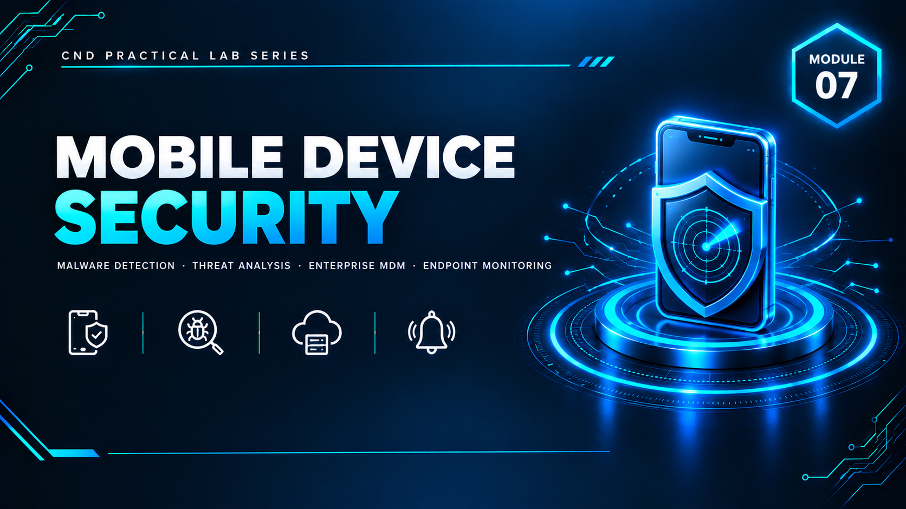

  

<h1>Module 07 — Mobile Device Security</h1>
<h3>Mobile Malware Detection &amp; Enterprise Device Management (Emsisoft &amp; Bitdefender)</h3>

 

  

<a href="#lab-setup"><b>Lab Setup</b></a> &nbsp;·&nbsp;
<a href="#part-1--emsisoft-mobile-security"><b>Emsisoft</b></a> &nbsp;·&nbsp;
<a href="#part-2--bitdefender-mobile-security--central"><b>Bitdefender</b></a> &nbsp;·&nbsp;
<a href="#key-takeaways"><b>Takeaways</b></a> &nbsp;·&nbsp;
<a href="#full-report"><b>Full Report</b></a>

 

---

## Executive Summary

This module evaluates mobile device security using two distinct approaches. The first demonstrates **standalone mobile malware detection and protection** using **Emsisoft Mobile Security**, where security scanning and threat identification were performed against a live malicious test file. The second demonstrates **Bitdefender Mobile Security with centralized enterprise management**, showing how a mobile device can be protected at the user level while simultaneously monitored and managed through an enterprise security platform (Bitdefender Central).

Together, the two labs demonstrate how modern mobile security solutions deliver malware prevention, threat detection, privacy protection, device monitoring, and centralized security management.

> All testing was performed using a dedicated lab Android device and a dedicated test malware sample — no personal or production devices were used.

 

## Lab Setup

| Component | Quantity | Purpose |
|---|---|---|
| Security Management Server | 1 | Centralized system for monitoring, reporting, and controlling mobile security activity (Bitdefender Central) |
| Mobile Device (Android) | 1 | Protected endpoint for installing security applications, performing scans, and testing detection |

 

## Part 1 — Emsisoft Mobile Security

**Objective:** analyze mobile device security using Emsisoft Mobile Security by performing malware detection and threat identification — scanning files, generating security alerts, and removing identified threats.

**Configuration performed:**
- Malware Scanner enabled with all scan options active
- Anomaly App Detection activated
- Scam Alert and Chat Protection enabled
- App Lock configured with usage access, security PIN, location access, and Smart Unlock

**Live malware test:** the IKARUS test malware sample was deliberately downloaded from APKPure to the protected device. Emsisoft detected the file immediately upon download, generated a real-time alert, and the malicious file was deleted within seconds — confirmed via the Emsisoft notification log.

 

## Part 2 — Bitdefender Mobile Security &amp; Central

**Objective:** implement comprehensive mobile security protection using Bitdefender Mobile Security while demonstrating enterprise-level device management through **Bitdefender Central**.

**Two security perspectives covered:**

<table>
<tr><th>Perspective</th><th>Capabilities Demonstrated</th></tr>
<tr><td><b>User-Level Protection</b></td><td>Malware scanning, Web Protection, Scam Protection (Scam Radar + Anomaly Detection), and application monitoring installed and enabled directly on the device</td></tr>
<tr><td><b>Enterprise-Level Management</b></td><td>Device enrolled into Bitdefender Central via QR code / install link, connected and visible on the centralized dashboard, remote actions (scan, anti-theft) available from the management console</td></tr>
</table>

**Live malware test:** the same IKARUS test sample was installed on the Bitdefender-protected device. Bitdefender detected and flagged the virus successfully, with the detection result visible centrally on the Bitdefender Central dashboard — demonstrating that enterprise visibility extends beyond the device itself to the management console.

 

## Comparison: Standalone vs. Enterprise-Managed Protection

<table>
<tr><th>Capability</th><th>Emsisoft Mobile Security</th><th>Bitdefender Mobile Security + Central</th></tr>
<tr><td>Malware scanning &amp; detection</td><td>✅</td><td>✅</td></tr>
<tr><td>Real-time threat removal</td><td>✅</td><td>✅</td></tr>
<tr><td>Scam / phishing protection</td><td>✅</td><td>✅</td></tr>
<tr><td>App Lock / anomaly detection</td><td>✅</td><td>✅ (Anomaly Detection)</td></tr>
<tr><td>Centralized enterprise dashboard</td><td>❌</td><td>✅</td></tr>
<tr><td>Remote scan / anti-theft actions</td><td>❌</td><td>✅</td></tr>
</table>

 

## Key Takeaways

- **Standalone endpoint protection works, but doesn't scale for organizations.** Emsisoft proved effective at detecting and removing a live malware sample on-device, but offers no central visibility for an administrator managing many devices.
- **Enterprise MDM-style platforms add the missing management layer.** Bitdefender Central demonstrated that a detection event on the device is also visible and actionable from a centralized console — the capability an organization actually needs at scale.
- **Live malware testing validates detection claims.** Rather than only configuring protection settings, both labs proved detection worked by introducing an actual test malware sample (IKARUS) and observing real-time response.
- **Mobile security requires layering, same as endpoint security** — malware defense, phishing/scam protection, application monitoring, and centralized oversight each cover different risk surfaces.

 

## Lab Environment

| | |
|---|---|
| **Devices** | 1 Android mobile device, 1 security management server |
| **Tools Used** | `Emsisoft Mobile Security` `Bitdefender Mobile Security` `Bitdefender Central` |
| **Test Sample** | IKARUS test malware (via APKPure) |
| **Scope** | Isolated lab device only — no personal or production data exposed |

 

## Full Report

The complete 35-page report — including every configuration screen for both platforms and the full live malware detection walkthrough — is available here:

📄 **[NS-M7.pdf](./NS-M7.pdf)**

 

## Disclaimer

This lab was conducted using a dedicated test device and a controlled test malware sample for educational purposes under the EC-Council CND curriculum. No production devices, personal data, or real malicious infrastructure were involved.

 

⬅ <a href="../"><b>Back to Main Repository</b></a>

