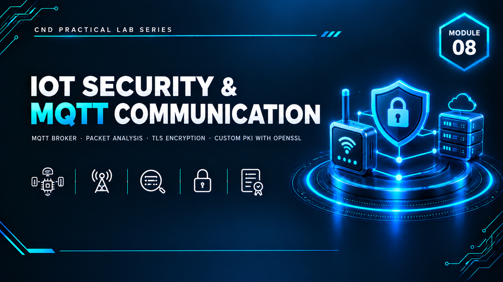

  

<h1>Module 08 — IoT Security</h1>
<h3>MQTT Communication, Plaintext Traffic Analysis &amp; TLS/PKI Implementation</h3>

 

  

<a href="#lab-topology"><b>Topology</b></a> &nbsp;·&nbsp;
<a href="#before--after-tls"><b>Before / After TLS</b></a> &nbsp;·&nbsp;
<a href="#custom-pki-with-openssl"><b>Custom PKI</b></a> &nbsp;·&nbsp;
<a href="#key-takeaways"><b>Takeaways</b></a> &nbsp;·&nbsp;
<a href="#full-report"><b>Full Report</b></a>

 

---

## Executive Summary

This module implements, configures, and security-analyzes an **IoT communication environment built on MQTT**. The objective was to establish communication between virtual IoT devices and an MQTT broker, then analyze the security implications of unencrypted IoT data transmission before and after hardening.

An MQTT channel was first established **without encryption** to observe plaintext message transmission, with **Wireshark** used to capture and prove that topics and payload data were fully readable in transit. TLS encryption was then implemented on the broker and IoT simulator — moving communication from standard MQTT (TCP/1883) to encrypted MQTT over TLS (TCP/8883) — and packet analysis confirmed the payload was no longer readable. Finally, a **custom Public Key Infrastructure** was built from scratch using OpenSSL (self-signed Root CA → server certificate → private key) to replace the broker's default auto-generated certificate, demonstrating real PKI chain management rather than relying on a vendor default.

> All testing was performed in an isolated virtual lab using simulated IoT devices — no real IoT hardware or production data was involved.

 

## Lab Topology

| VMnet | Type | Subnet | Purpose |
|---|---|---|---|
| VMnet1 | Host-Only | `192.168.10.0/24` | Internal lab network |
| VMnet3 | NAT | `192.168.100.0/24` | DHCP-enabled network |

<table>
<tr><th>VM</th><th>Role</th><th>Software</th></tr>
<tr><td><b>Web Server</b></td><td>MQTT Broker</td><td>Bevywise CrystalMQ 5.0 (build 0821-024) — TCP port 1883 (unencrypted) / 8883 (TLS); dashboard at <code>:8080</code></td></tr>
<tr><td><b>Admin Machine-1</b></td><td>IoT Client Simulator</td><td>Bevywise IoT Simulator — used to create and manage virtual IoT devices</td></tr>
</table>

A custom network (`ABC`) with a simulated temperature device (`Temp` / ID `TSI`) was created and connected to the broker, with a custom command topic (`High-Tempe`) subscribed for testing.

 

## Before / After TLS

<table>
<tr><th>Stage</th><th>Port</th><th>Wireshark Evidence</th><th>Result</th></tr>
<tr><td><b>Before — Plaintext MQTT</b></td><td>TCP 1883</td><td>TCP stream follow on <code>tcp.port==1883</code> showed the topic name and command (<code>High-Tempe</code>) fully readable in clear text</td><td>❌ Confirmed: any network-positioned attacker (MITM) could read IoT topics and payloads directly</td></tr>
<tr><td><b>After — TLS-Encrypted MQTT</b></td><td>TCP 8883</td><td>TCP stream follow on <code>tcp.port==8883</code> showed only unreadable binary/ciphertext, with just TLS handshake certificate metadata (Common Name, Organization, validity dates) visible in plaintext — expected and non-sensitive</td><td>✅ Confirmed: actual MQTT topic/payload data fully encrypted and unreadable to a network sniffer</td></tr>
</table>

 

## Custom PKI with OpenSSL

Rather than relying on CrystalMQ's auto-generated TLS certificate, a complete self-signed PKI chain was built manually:

| Step | Artifact | Purpose |
|---|---|---|
| 1 | `rootCA.key` / `rootCA.crt` | Self-signed Root Certificate Authority |
| 2 | Server key + CSR | Server identity and certificate signing request |
| 3 | `server.crt` (signed by Root CA) | Broker's TLS server certificate |
| 4 | Certificate deployment | Default broker certs backed up (`.bak`), replaced with the custom chain on the broker; Root CA distributed to and trusted by the IoT Simulator client |

After deployment, the broker was restarted (`runbroker`), the simulator network was cycled to re-establish a TLS session under the new certificate chain, and Wireshark re-confirmed the MQTT payload remained fully encrypted under the custom PKI — proving the self-signed chain functioned identically to the vendor default while giving full control over certificate issuance and trust.

 

## Key Takeaways

- **Unencrypted IoT protocols are trivially sniffable.** The plaintext MQTT capture directly proved that topics and commands are readable by anyone with network access — a realistic risk in flat or poorly segmented IoT networks.
- **TLS is necessary, not optional, for IoT telemetry.** Moving from port 1883 to 8883 with certificate-based TLS eliminated payload visibility entirely, verified empirically rather than assumed.
- **Owning the PKI chain matters.** Building a custom Root CA, server certificate, and private key — rather than trusting a vendor's auto-generated certificate — demonstrates the actual trust model behind TLS and gives an organization control over certificate lifecycle and revocation.
- **Verification must happen at the packet level.** Configuration screens showing "TLS Enabled" are not proof of security — Wireshark packet capture was used at every stage to directly confirm what was and wasn't visible on the wire.

 

## Lab Environment

| | |
|---|---|
| **Hypervisor** | VMware Workstation |
| **MQTT Broker** | Bevywise CrystalMQ (MQTTRoute) |
| **IoT Client** | Bevywise IoT Simulator |
| **Analysis Tool** | Wireshark |
| **PKI Tool** | OpenSSL |
| **Scope** | Isolated lab only — simulated IoT devices, zero production exposure |

 

## Full Report

The complete 44-page report — including every broker/simulator configuration step, the full plaintext vs. TLS Wireshark comparison, and the complete OpenSSL PKI build — is available here:

📄 **[NS-M8.pdf](./NS-M8.pdf)**

 

## Disclaimer

This lab was conducted in a private, isolated virtual environment using simulated IoT devices for educational purposes under the EC-Council CND curriculum. No real IoT hardware, production networks, or live targets were accessed or affected.

 

⬅ <a href="../"><b>Back to Main Repository</b></a>

