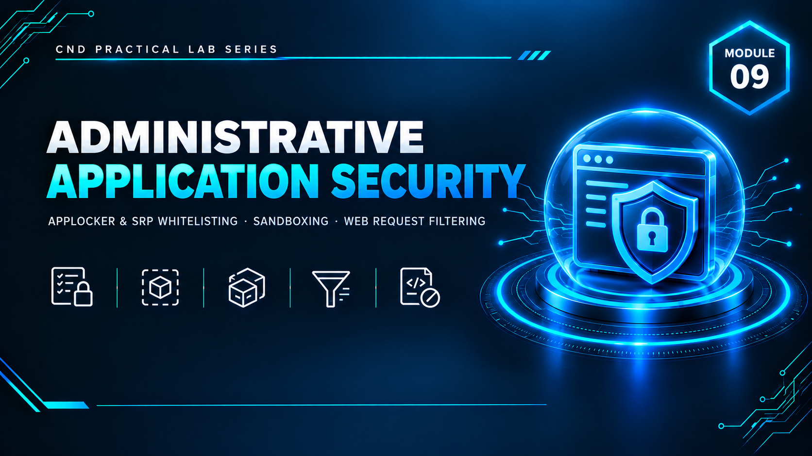

  

<h1>Module 09 — Administrative Application Security</h1>
<h3>Application Whitelisting, Sandboxing &amp; Web Request Filtering Across Windows &amp; Linux</h3>

 

  

<a href="#lab-topology"><b>Topology</b></a> &nbsp;·&nbsp;
<a href="#lab-summary"><b>Lab Summary</b></a> &nbsp;·&nbsp;
<a href="#tool-substitutions"><b>Tool Substitutions</b></a> &nbsp;·&nbsp;
<a href="#key-takeaways"><b>Takeaways</b></a> &nbsp;·&nbsp;
<a href="#full-report"><b>Full Report</b></a>

 

---

## Executive Summary

Module 9 focuses on **Administrative Application Security** — implementing and validating application-level controls across Windows and Linux: application whitelisting, sandboxing, and web application filtering. Across five hands-on labs, three core defense strategies were demonstrated: restricting which applications can execute (**AppLocker**, **Software Restriction Policies**), isolating untrusted code from the host system (**Firejail**, **Sandboxie-Plus**), and filtering malicious web requests at the server level (**IIS Request Filtering**).

Every control was configured, tested, and — critically — **verified through live attack simulation rather than assumed to work from configuration alone**. Two labs required tool substitutions due to the originally specified tools being discontinued or paywalled (Microsoft URLScan → IIS Request Filtering; Shade Sandbox → Sandboxie-Plus); both substitutes were selected specifically to preserve the original lab's security objective and are documented as functionally equivalent.

A notable strength of this module was the troubleshooting encountered in Labs 1–2, where a real **AppLocker/SRP enforcement conflict** was diagnosed and resolved rather than glossed over — producing a more technically credible result than simply following a script.

> All testing was performed in a fully isolated virtual lab with no connection to production systems. Real (contained) malware samples were used safely within sandboxed environments only.

 

## Lab Topology

| VM | OS | VMnet1 (Host-Only) | VMnet3 (NAT) | Primary Use |
|---|---|---|---|---|
| Machine 1 | Ubuntu 64-bit | `192.168.10.20` | `192.168.100.135` | Attacker (Lab 1) |
| Machine 2 | Windows Server 2019 | `192.168.10.4` | `192.168.100.131` | Web Server (Lab 1) |
| Machine 3 | Windows 10 | `192.168.10.3` | `192.168.100.128` | Admin (Lab 2) |

 

## Lab Summary

<table>
<tr><th>Lab</th><th>Objective</th><th>Tool Used</th><th>Result</th></tr>
<tr><td><b>1</b></td><td>Application whitelisting via domain-style policy</td><td>AppLocker (Local Security Policy)</td><td>Rules enforced; blocked application confirmed via live test</td></tr>
<tr><td><b>2</b></td><td>Alternative whitelisting mechanism</td><td>Software Restriction Policies (SRP)</td><td>Rules enforced; block verified after isolating an AppLocker interference conflict</td></tr>
<tr><td><b>3</b></td><td>Sandboxing untrusted applications (Linux)</td><td>Firejail</td><td>Network + filesystem isolation proven; <code>--private</code> mode validated as genuinely isolating the home directory</td></tr>
<tr><td><b>4</b></td><td>Blocking web-based attacks (XSS) at the server</td><td>IIS Request Filtering (substitute for URLScan)</td><td>XSS payload blocked (HTTP 404) after filter applied</td></tr>
<tr><td><b>5</b></td><td>Safe execution of untrusted/malicious files</td><td>Sandboxie-Plus (substitute for Shade Sandbox)</td><td>Real malware executed safely in isolation; host system unaffected</td></tr>
</table>

 

## Tool Substitutions

<table>
<tr><th>Original Tool (Specified)</th><th>Status</th><th>Substitute Used</th><th>Why It's Equivalent</th></tr>
<tr><td>Microsoft URLScan</td><td>Discontinued by Microsoft</td><td>IIS Request Filtering</td><td>Native IIS feature providing the same request-level filtering capability — blocking malicious query strings/payloads before they reach the application</td></tr>
<tr><td>Shade Sandbox</td><td>Paid / gated licensing</td><td>Sandboxie-Plus</td><td>Free, actively maintained, provides the same isolated-execution sandbox model for safely running untrusted or malicious files</td></tr>
</table>

 

## Lab 1–2 Highlight: Diagnosing a Real AppLocker/SRP Conflict

Rather than treating a failed test as a dead end, the enforcement conflict between AppLocker (Lab 1) and Software Restriction Policies (Lab 2) running simultaneously on the same machine was actively diagnosed and isolated before SRP's block could be properly verified — demonstrating a troubleshooting workflow (missing dependencies, context issues, overlapping policy engines) that mirrors real-world administrative security work rather than a scripted walkthrough.

## Lab 3 Highlight: Proving Firejail Isolation

Isolation claims were tested empirically, not assumed:
- A file written inside a default Firejail sandbox was checked for persistence outside the sandbox (proving shared vs. isolated `/tmp` behavior).
- `firejail --private bash` was used to prove stronger isolation — a file written to `~` inside the sandbox did **not** exist on the real system after exit, confirming genuinely isolated home-directory behavior.
- `firejail --list` was used to demonstrate live monitoring of active sandboxes, a necessary administrative capability beyond just launching isolation.

## Lab 5 Highlight: Safe Malware Execution

A real malware sample was executed inside Sandboxie-Plus to validate that sandboxed execution plus Windows Defender (defense in depth) contains the threat without affecting the host OS — followed by documented cleanup procedures, mirroring how a security analyst safely triages a suspicious file during incident response.

 

## Key Takeaways

- **Trust nothing by default, and verify it.** Every control in this module was proven with a live test — a blocked execution attempt, a persisted/non-persisted test file, a blocked HTTP request — rather than accepted on the strength of a configuration screen.
- **Overlapping security mechanisms can conflict.** AppLocker and SRP enforcing policy simultaneously produced a real conflict that had to be diagnosed, not just worked around — a realistic lesson in layered control design.
- **Tool deprecation is a real operational constraint.** Selecting functionally equivalent substitutes (IIS Request Filtering, Sandboxie-Plus) when originally specified tools are discontinued or paywalled reflects actual field conditions, and the underlying control objective — not the specific vendor product — is what matters.
- **Isolation claims should be tested, not trusted.** The Firejail `--private` tests proved isolation empirically by checking for file persistence across the sandbox boundary.
- **Defense in depth works even for malware handling** — sandbox isolation plus endpoint protection (Windows Defender) together contained a real malicious sample safely.

 

## Lab Environment

| | |
|---|---|
| **Hypervisor** | VMware Workstation |
| **Operating Systems** | Windows Server 2019 · Windows 10 · Ubuntu 64-bit |
| **Tools Used** | `AppLocker` `Software Restriction Policies` `Firejail` `IIS Request Filtering` `Sandboxie-Plus` |
| **Scope** | Isolated lab only — zero production exposure |

 

## Full Report

The complete 58-page report — including every AppLocker/SRP rule configuration, the full Firejail isolation test sequence, IIS Request Filtering setup, and the Sandboxie-Plus malware containment walkthrough — is available here:

📄 **[NS-M9.pdf](./NS-M9.pdf)**

 

## Disclaimer

This lab was conducted in a private, isolated virtual environment built solely for educational purposes under the EC-Council CND curriculum. Any malware samples used were executed only within sandboxed, isolated environments with no connection to production systems.

 

⬅ <a href="../"><b>Back to Main Repository</b></a>

