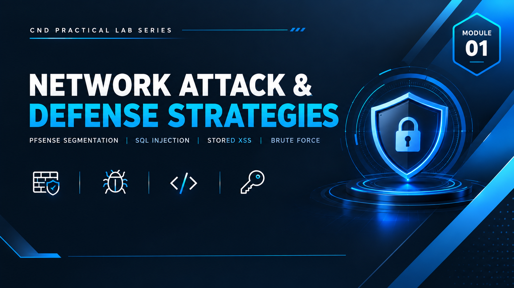

  

<h1>Module 01 — Network Segmentation & Web Application Attack Simulation</h1>
<h3>pfSense Firewall Deployment &amp; Multi-Stage Attack Chain Against a Vulnerable ASP.NET Application</h3>

 

  

<a href="#lab-topology"><b>Topology</b></a> &nbsp;·&nbsp;
<a href="#attack-chain"><b>Attack Chain</b></a> &nbsp;·&nbsp;
<a href="#findings-summary"><b>Findings</b></a> &nbsp;·&nbsp;
<a href="#key-takeaways"><b>Takeaways</b></a> &nbsp;·&nbsp;
<a href="#full-report"><b>Full Report</b></a>

 

---

## Executive Summary

This module documents the setup and execution of a controlled network security lab built in **VMware Workstation**, demonstrating fundamental network segmentation using **pfSense** as a firewall/router, and illustrating how a poorly secured web application can be exploited through multiple chained attack vectors.

The environment consists of three virtual machines — a pfSense firewall, a Kali Linux attacker machine on the WAN side, and a Windows Server 2019 victim hosting a vulnerable ASP.NET web application on the LAN side, separated by the pfSense firewall. Four sequential attack phases — **reconnaissance, SQL injection, stored XSS, and credential brute-forcing** — were carried out to demonstrate that weak input validation combined with absent account lockout policies results in full system compromise, even behind a correctly configured firewall.

> All testing was performed in a fully isolated host-only / NAT virtual network with no connection to production systems. All credentials, IP addresses, and payloads shown are disposable lab-only values.

 

## Lab Topology

<table>
<tr><th>VM</th><th>Operating System</th><th>Role</th></tr>
<tr><td><b>pfSense</b></td><td>pfSense 2.7.2-RELEASE</td><td>Firewall / Router — network segmentation boundary</td></tr>
<tr><td><b>Attacker</b></td><td>Kali Linux (Rolling)</td><td>External attack machine — WAN side</td></tr>
<tr><td><b>Victim</b></td><td>Windows Server 2019</td><td>Web server (IIS + ASP.NET) — LAN side</td></tr>
</table>

 

**Network Segmentation**

| VMnet | Type | Subnet | Purpose |
|---|---|---|---|
| VMnet8 | NAT | `192.168.80.0/24` | WAN — pfSense WAN interface + Attacker (Kali) |
| VMnet3 | Host-Only | `192.168.30.0/24` | LAN — pfSense LAN interface + Victim (Windows Server) |

**IP Address Allocation**

| Device | Interface | IP Address | Assignment |
|---|---|---|---|
| pfSense | WAN (em0) | `192.168.80.132/24` | DHCP via VMnet8 (NAT) |
| pfSense | LAN (em1) | `192.168.30.99/24` | Static — configured manually |
| Attacker (Kali) | eth0 | `192.168.80.129/24` | DHCP via VMnet8 — same subnet as WAN |
| Victim (Windows) | eth0 | `192.168.30.113/24` | DHCP from pfSense LAN pool |

The attacker sits on the WAN side simulating an external threat actor, with its default route pointed at the pfSense WAN IP. The victim sits behind pfSense on an isolated host-only LAN, receiving its address from the pfSense DHCP pool — confirming correct network placement before any attack traffic was sent.

 

## Attack Chain

A four-phase attack was executed against the victim's web application (`192.168.30.113`) from the attacker machine (`192.168.80.129`), chaining reconnaissance into full authenticated access.

<table>
<tr><th>Phase</th><th>Technique</th><th>Tool</th><th>Outcome</th></tr>
<tr><td><b>1</b></td><td>Reconnaissance — SYN stealth scan, evasion timing &amp; packet fragmentation</td><td><code>Nmap</code></td><td>Identified open ports 135, 139, 445 (msrpc, netbios-ssn, microsoft-ds) and fingerprinted the target as Windows; pivoted to HTTP on port 80</td></tr>
<tr><td><b>2</b></td><td>Boolean-based Blind SQL Injection against <code>Login.aspx</code></td><td><code>Burp Suite</code></td><td>Full authentication bypass without valid credentials</td></tr>
<tr><td><b>3</b></td><td>Stored Cross-Site Scripting via the Comments page</td><td>Manual payload injection</td><td>Malicious JavaScript persists in the database and executes in every visitor's (including admin's) browser</td></tr>
<tr><td><b>4</b></td><td>Username enumeration + password brute force</td><td><code>Hydra</code></td><td>Valid credentials recovered for multiple accounts, including <code>admin</code></td></tr>
</table>

**Full compromise path:** network scan → Windows target fingerprinted behind pfSense → SQL injection bypasses the login page with zero valid credentials → stored XSS compromises any user who views the Comments page → Hydra brute force extracts working credentials → persistent authenticated access achieved.

 

## Findings Summary

<table>
<tr><th>Finding</th><th>Detail</th></tr>
<tr><td><b>Vulnerable Parameter</b></td><td><code>username</code> field, <code>POST /Login.aspx</code></td></tr>
<tr><td><b>Injection Type</b></td><td>Boolean-based Blind SQL Injection</td></tr>
<tr><td><b>Backend Database</b></td><td>Microsoft SQL Server (ASP.NET + Microsoft-IIS/10.0 confirmed)</td></tr>
<tr><td><b>Authentication Impact</b></td><td>Complete login bypass without valid credentials</td></tr>
<tr><td><b>XSS Vector</b></td><td>Unsanitized, unencoded user input stored and rendered on <code>Comments.aspx</code></td></tr>
<tr><td><b>XSS Impact</b></td><td>Session hijacking, credential theft via fake login overlays, phishing injection, potential admin account takeover</td></tr>
<tr><td><b>Brute Force Weakness</b></td><td>No account lockout policy; weak, reused password (<code>admin123</code>) valid across multiple enumerated accounts (<code>admin</code>, <code>alice</code>, <code>john</code>)</td></tr>
<tr><td><b>Root Cause</b></td><td>Unsanitized database queries, missing output encoding, and absent authentication throttling controls</td></tr>
</table>

 

## Key Takeaways

- **Network segmentation is not application security.** pfSense correctly isolated the victim on a protected LAN, but firewall-level controls alone do not stop application-layer attacks once traffic is permitted through.
- **SQL Injection** arises from unsanitized database queries and must be mitigated with parameterized queries or prepared statements — never string-concatenated SQL.
- **Stored XSS persists** in the database and silently compromises every subsequent viewer of the page. All user-supplied input must be HTML-encoded before rendering.
- **Brute-force attacks succeed** when no account lockout, rate limiting, or CAPTCHA is enforced, and when weak/reused passwords are permitted.
- Poor input validation combined with weak authentication controls equals catastrophic exposure — **even behind a properly configured firewall.**

 

## Lab Environment

| | |
|---|---|
| **Hypervisor** | VMware Workstation |
| **Networking** | VMnet8 (NAT) + VMnet3 (Host-Only), segmented via pfSense |
| **Tools Used** | `pfSense` `Nmap` `Burp Suite Community Edition` `Hydra` |
| **Scope** | Isolated lab only — zero production exposure |

 

## Full Report

The complete 24-page report — including every configuration step, screenshot, Burp Suite request/response pair, Hydra output, and the full attack narrative — is available here:

📄 **[report.pdf](./report.pdf)**

 

## Disclaimer

This lab was conducted in a private, isolated virtual environment built solely for educational purposes under the EC-Council CND curriculum. No real production systems, networks, or live targets were accessed or affected. All credentials, IP addresses, and payloads shown are lab-only values with no validity outside this sandbox.

 

⬅ <a href="../"><b>Back to Main Repository</b></a>

