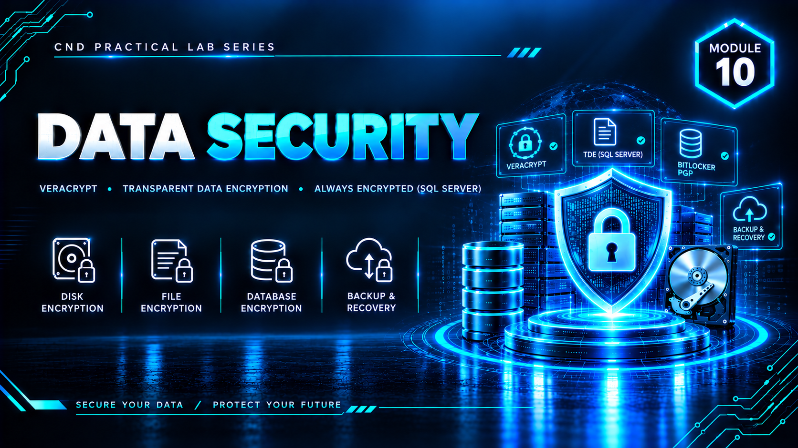

  

<h1>Module 10 — Data Security</h1>
<h3>Encryption at Rest, in Transit &amp; Backup/Recovery — 3 Volumes, 11 Labs</h3>

 

  

<a href="#volume-1--encryption-at-rest"><b>Volume 1</b></a> &nbsp;·&nbsp;
<a href="#volume-2--transit-encryption-secure-comms--backup"><b>Volume 2</b></a> &nbsp;·&nbsp;
<a href="#volume-3--filepartition-recovery--disk-encryption"><b>Volume 3</b></a> &nbsp;·&nbsp;
<a href="#key-takeaways"><b>Takeaways</b></a> &nbsp;·&nbsp;
<a href="#full-reports"><b>Full Reports</b></a>

 

---

## Executive Summary

Module 10 is the most extensive module in this portfolio, covering **Data Security across 11 labs in three volumes**: encryption at rest, encryption in transit, secure communication, backup, and both file- and partition-level recovery. Together, the volumes demonstrate the complete data-governance lifecycle — protecting data wherever it lives, proving that "deleted" doesn't mean "destroyed," and showing that encryption is the control that actually blocks unauthorized access even with full physical disk access.

> All testing was performed in a fully isolated virtual lab, deliberately never touching production or system drives. All credentials, keys, and recovered content shown are disposable lab-only values.

 

## Volume 1 — Encryption at Rest

**VeraCrypt · SQL Server TDE · Always Encrypted**

<table>
<tr><th>Lab</th><th>Technique</th><th>Result</th></tr>
<tr><td>1</td><td><b>VeraCrypt</b> file-container encryption (AES)</td><td>Encrypted volume created, mounted, and unmounted — the container becomes completely unreadable while unmounted, confirming strong file-level encryption</td></tr>
<tr><td>2</td><td><b>Transparent Data Encryption (TDE)</b> on SQL Server</td><td>Database Master Key, certificate, and Database Encryption Key created; full database files and backups encrypted at the storage level</td></tr>
<tr><td>3</td><td><b>Always Encrypted</b> (column-level)</td><td>Column Master Key configured; the <code>Empid</code> column displays as unreadable ciphertext (e.g. <code>0x01210B169F...</code>) directly in SSMS — proving even a privileged DBA cannot view the raw value, since encryption/decryption happens client-side</td></tr>
</table>

**Lab Environment:** VMnet1 (Host-Only, `192.168.10.0/24`) + VMnet3 (NAT, `192.168.100.0/24`); four VMs (Server-1, Web Server, Finance-Dept, AdminMachine-1).

 

## Volume 2 — Transit Encryption, Secure Comms &amp; Backup

**SSL/TLS · OpenPGP (Gpg4win/Kleopatra) · AOMEI Backupper · EaseUS Data Recovery**

<table>
<tr><th>Lab</th><th>Technique</th><th>Result</th></tr>
<tr><td>4</td><td><b>SSL/TLS on a self-hosted WordPress site</b> (WampServer + Apache)</td><td>Self-signed certificate generated and bound to Apache; site successfully served over HTTPS, confirming encrypted browser-to-server communication (the browser's "Not Secure" label reflects only the self-signed cert, not a functional failure)</td></tr>
<tr><td>5</td><td><b>OpenPGP secure email</b> (Gpg4win + Kleopatra)</td><td>Key pair generated, public key exported, private key backed up; a message was encrypted and then successfully decrypted only by the holder of the correct private key and passphrase</td></tr>
<tr><td>6</td><td><b>File backup</b> (AOMEI Backupper Standard)</td><td>Full backup of a test folder created to a separate destination and verified intact</td></tr>
<tr><td>7</td><td><b>File recovery</b> (EaseUS Data Recovery Wizard)</td><td>The Lab 6 backup folder was intentionally deleted, then recovered via disk scan with original filename, correct size, and no corruption — confirming recovery succeeds as long as disk space hasn't been overwritten</td></tr>
</table>

 

## Volume 3 — File/Partition Recovery &amp; Disk Encryption

**Kernel for Windows Data Recovery · MiniTool Power Data Recovery · BitLocker · Disk Drill**

<table>
<tr><th>Lab</th><th>Technique</th><th>Result</th></tr>
<tr><td>8</td><td><b>File-level recovery</b> (Kernel for Windows Data Recovery)</td><td>Permanently deleted files on the C: drive were correctly located and detected by a full scan; final save was blocked by the trial license — a licensing limitation, not a detection failure</td></tr>
<tr><td>9</td><td><b>Partition-level recovery</b> (MiniTool Power Data Recovery)</td><td>An entire deliberately deleted partition was located via deep scan and a file inside it successfully recovered and verified</td></tr>
<tr><td>10</td><td><b>Full-disk encryption</b> (BitLocker)</td><td>A dedicated non-system test drive encrypted with XTS-AES 128, protected by both a password and a backed-up recovery key; lock/unlock behavior verified via command line</td></tr>
<tr><td>11</td><td><b>File recovery after Recycle Bin emptying</b> (Disk Drill)</td><td>Deep scan located 18 files (8 documents, 6 archives, 4 other); a document and an archive were recovered to a separate destination with verified, non-corrupted content</td></tr>
</table>

 

## Key Takeaways

- **Recovery and encryption are two sides of the same coin.** Labs 8, 9, and 11 proved that "deleted" data is recoverable until overwritten — a reactive capability. Lab 10 (BitLocker) proved the preventive counterpart: a properly encrypted volume stays unreadable even with full physical access, regardless of deletion status.
- **A resilient data strategy needs both.** Recovery tooling protects against accidental loss; encryption protects against unauthorized access — an organization needs tested recovery procedures *and* encrypted sensitive volumes with securely stored recovery keys.
- **Encryption should match the right layer to the right risk:** VeraCrypt for individual sensitive files, TDE for whole-database protection at rest, Always Encrypted for specific sensitive columns even DBAs shouldn't read, SSL/TLS for data in motion, and OpenPGP for message-level confidentiality.
- **Licensing limitations are not the same as technical failure** — Lab 8's trial block on the final recovery step still fully validated detection accuracy, an important distinction in a lab report.
- **All recovery testing stayed strictly within isolated virtual test disks and partitions**, never touching production or system drives — a deliberate safety discipline throughout all three volumes.

 

## Lab Environment

| | |
|---|---|
| **Hypervisor** | VMware Workstation |
| **Networking** | VMnet1 (Host-Only) + VMnet3 (NAT) |
| **Tools Used** | `VeraCrypt` `SQL Server TDE` `Always Encrypted` `Apache/SSL` `Gpg4win / Kleopatra` `AOMEI Backupper` `EaseUS Data Recovery Wizard` `Kernel for Windows Data Recovery` `MiniTool Power Data Recovery` `BitLocker` `Disk Drill` |
| **Scope** | Isolated virtual disks/partitions only — zero production or system drive exposure |

 

## Full Reports

<table>
<tr><td>📄 <b>Volume 1</b> — Encryption at Rest</td><td><a href="./NS-M10v1.pdf">Volume-1-Encryption-at-Rest.pdf</a></td></tr>
<tr><td>📄 <b>Volume 2</b> — Transit Encryption, Backup &amp; Recovery</td><td><a href="./NS-M10v2.pdf">Volume-2-Transit-Backup-Recovery.pdf</a></td></tr>
<tr><td>📄 <b>Volume 3</b> — Partition Recovery &amp; BitLocker</td><td><a href="./NS-M10v3.pdf">Volume-3-Partition-Recovery-BitLocker.pdf</a></td></tr>
</table>

 

## Disclaimer

This lab was conducted in a private, isolated virtual environment built solely for educational purposes under the EC-Council CND curriculum. All recovery and encryption testing was performed exclusively on dedicated virtual test disks and partitions — no production or system drives were touched. All credentials, keys, and recovered data shown are lab-only values.

 

⬅ <a href="../"><b>Back to Main Repository</b></a>

