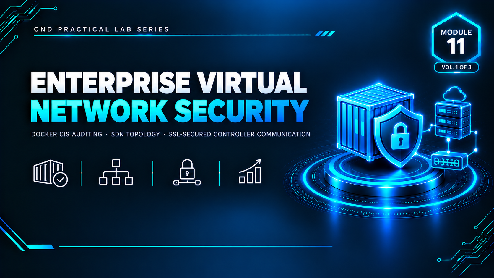

  

<h1>Module 11 — Enterprise Virtual Network Security</h1>
<h3>Docker Host Hardening &amp; SDN Controller SSL/TLS Security</h3>

 

  

<a href="#lab-1--docker-host-security-auditing"><b>Docker Audit</b></a> &nbsp;·&nbsp;
<a href="#lab-2--securing-sdn-communication-with-ssl"><b>SDN/SSL</b></a> &nbsp;·&nbsp;
<a href="#key-takeaways"><b>Takeaways</b></a> &nbsp;·&nbsp;
<a href="#full-report"><b>Full Report</b></a>

 

---

## Executive Summary

Module 11 covers two essential infrastructure security practices: **Docker host security auditing** and **Software-Defined Network (SDN) security with SSL/TLS**. The two labs demonstrate container-platform hardening validated against industry benchmarks, and the practical, measurable impact of securing — or misconfiguring — the SDN control plane.

> All testing was performed in a fully isolated virtual lab with no connection to production systems.

 

## Lab Topology

| VMnet | Type | Subnet | Purpose |
|---|---|---|---|
| VMnet1 | Host-Only | `192.168.10.0/24` | Internal lab network |
| VMnet3 | NAT | `192.168.100.0/24` | DHCP-enabled, internet access for tool installation |

| Lab | Services Running |
|---|---|
| Lab 1 | Docker Engine, Docker-Bench-Security, CIS security audit |
| Lab 2 | Mininet, SDN Controller, SSL configuration, Open vSwitch |

Both labs were performed on a single Ubuntu VM.

 

## Lab 1 — Docker Host Security Auditing

**Tooling:** `Docker-Bench-Security` — audits a Docker host configuration against CIS Benchmarks.

**Process:**
1. Docker Engine installed on Ubuntu with administrative privileges verified
2. Docker-Bench-Security installed via Git
3. Initial baseline security audit run against CIS Benchmarks
4. Hardening measures applied — daemon configuration adjustments and **Docker Content Trust** enabled (enforcing image signature verification)
5. Audit re-run to validate the improvements

**Result:**

| Stage | Docker-Bench-Security Score |
|---|---|
| Before hardening | 2 |
| After hardening | **9** |

This before/after comparison directly validates that the applied hardening measures produced a measurable, benchmark-verified improvement in Docker host security posture.

 

## Lab 2 — Securing SDN Communication with SSL

**Tooling:** `Mininet`, `MiniEdit`, `Open vSwitch` — a virtual Software-Defined Networking topology with two hosts (`h1`, `h2`), one OpenFlow switch (`s1`), and one SDN controller (`c0`) providing centralized network control.

**Baseline test (before SSL):**
- `h1` pinged `h2` successfully through `s1`, controlled by `c0`
- Result: **0% packet loss** — confirming hosts, links, Open vSwitch, and the controller were all functioning correctly

**SSL configuration:**
- Topology stopped
- Controller protocol changed from standard (unencrypted) communication to **SSL**
- NetFlow and sFlow monitoring enabled on the configurable OpenFlow switch
- Topology restarted and connectivity re-tested

**Result after SSL (before certificate provisioning):**
- `h1` → `h2` ping: **"Destination Host Unreachable" — 100% packet loss**
- This matched the expected outcome documented in the lab manual: without a properly certificate-provisioned SSL channel, the switch cannot receive valid flow-forwarding instructions from the controller, so data-plane forwarding between hosts fails entirely.

 

## Key Takeaways

- **Security auditing validates configuration against real industry benchmarks**, not just a checklist — the Docker-Bench-Security score moving from 2 to 9 is a concrete, repeatable measurement of improved posture.
- **The SDN control plane is a single point of failure as well as a security boundary.** Enabling SSL on the controller channel without the certificate infrastructure to support it broke switch-to-controller communication entirely — demonstrating that securing the control plane *correctly* is non-negotiable, not optional.
- **Security changes must be tested before and after, every time.** Both labs follow the same rigorous pattern: baseline measurement → change applied → re-test → documented before/after comparison, rather than assuming a configuration change worked.
- **Breaking something on purpose teaches a real lesson.** The 100% packet loss after the SSL change isn't a failure of the lab — it's the demonstrated proof that the controller-switch channel is critical infrastructure, and that misconfiguring its security has an immediate, measurable operational impact.

 

## Lab Environment

| | |
|---|---|
| **Hypervisor** | VMware Workstation |
| **OS** | Ubuntu |
| **Tools Used** | `Docker` `Docker-Bench-Security` `Mininet` `MiniEdit` `Open vSwitch` `OpenFlow` |
| **Scope** | Isolated lab only — zero production exposure |

 

## Full Report

The complete 43-page report — including every Docker hardening step with before/after audit output, and the full Mininet/SDN topology build and SSL connectivity test — is available here:

📄 **[report.pdf](./report.pdf)**

 

## Disclaimer

This lab was conducted in a private, isolated virtual environment built solely for educational purposes under the EC-Council CND curriculum. No real production systems or networks were accessed or affected.

 

⬅ <a href="../"><b>Back to Main Repository</b></a>

