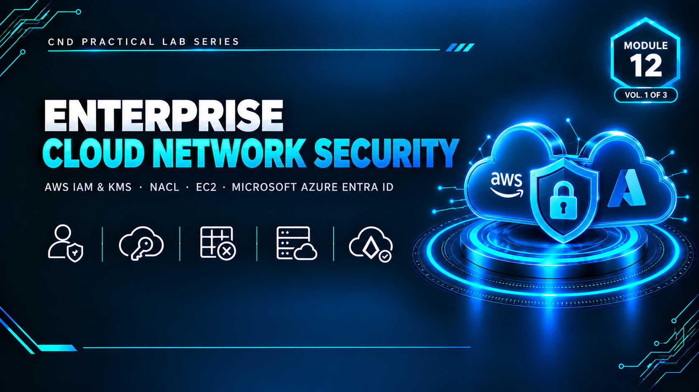

  

<h1>Module 12 — Enterprise Cloud Network Security</h1>
<h3>AWS IAM, KMS, NACL &amp; EC2 and Microsoft Azure Entra ID — A Multi-Cloud Security Track</h3>

 

  

<a href="#lab-summary"><b>Lab Summary</b></a> &nbsp;·&nbsp;
<a href="#lab-3-highlight-stateful-vs-stateless-controls"><b>Stateful vs. Stateless</b></a> &nbsp;·&nbsp;
<a href="#key-takeaways"><b>Takeaways</b></a> &nbsp;·&nbsp;
<a href="#full-report"><b>Full Report</b></a>

 

---

## Executive Summary

Module 12 builds the practical skills needed to secure enterprise workloads hosted on **Amazon Web Services (AWS)** and **Microsoft Azure**. Working inside a controlled virtual lab anchored by a **pfSense firewall gateway**, five progressive hands-on labs configure foundational cloud security controls spanning identity, encryption, network segmentation, compute, and multi-cloud identity governance.

> Cloud resources provisioned during this module were trial/free-tier only and deliberately disabled or terminated after each lab to avoid unintended charges — a deliberate practice of responsible cloud hygiene carried throughout.

 

## Lab Topology

A **pfSense firewall** serves as the gateway between WAN and LAN for the lab environment — the WAN adapter connects to the internet (bridged/NAT), and the LAN adapter forms the isolated internal network the Admin Machine uses to reach all cloud consoles and tools.

 

## Lab Summary

<table>
<tr><th>Lab</th><th>Platform</th><th>Focus</th><th>Key Actions</th></tr>
<tr><td><b>1</b></td><td>AWS</td><td>Identity and Access Management (IAM)</td><td>Created an IAM Group and IAM User, attached a permission policy, built a custom IAM policy scoped to CloudFront, and enabled Multi-Factor Authentication — enforcing least privilege for user access</td></tr>
<tr><td><b>2</b></td><td>AWS</td><td>Key Management Service (KMS)</td><td>Generated a symmetric customer-managed master key and applied it to encrypt an S3 bucket and an EBS volume — protecting data confidentiality at rest</td></tr>
<tr><td><b>3</b></td><td>AWS</td><td>Network Access Control Lists (NACL)</td><td>Provisioned a custom VPC with an internet gateway and public subnet, launched an EC2 instance, then attached a custom NACL denying all inbound/outbound traffic — proving stateless subnet-level rules can override permissive security-group settings</td></tr>
<tr><td><b>4</b></td><td>AWS</td><td>EC2 Instance Management</td><td>Established an SSH connection via PuTTY, managed instance lifecycle, configured an S3 bucket policy for public access, and confirmed the Lab 3 NACL correctly blocks the SSH connection once applied</td></tr>
<tr><td><b>5</b></td><td>Microsoft Azure</td><td>Entra ID (formerly Azure AD)</td><td>Created an Azure free account, provisioned a user in Microsoft Entra ID, activated a Microsoft Entra Suite trial, and enabled per-user MFA — mirroring the AWS IAM workflow on a competing cloud platform</td></tr>
</table>

 

## Lab 3 Highlight: Stateful vs. Stateless Controls

One of the module's most important practical lessons came from directly observing the difference between **security groups** (stateful — track connection state) and **NACLs** (stateless — evaluate every packet independently). An EC2 instance with a fully permissive security group still became completely unreachable once a restrictive custom NACL was attached to its subnet — demonstrating that:

- NACLs operate at the subnet level and apply to **every** instance in that subnet, regardless of individual security group rules
- An overly restrictive NACL can **silently block legitimate traffic** even when the security group would otherwise allow it
- This is a subtle, easy-to-miss misconfiguration risk in real AWS environments — made tangible here through direct, hands-on observation rather than just reading about it

 

## Key Takeaways

- **Cloud security is layered, not singular.** IAM/Entra ID governs *who* can act; KMS encryption limits *what* an adversary can read if access is breached; NACLs/VPC design limit *how far* a threat can move laterally; MFA adds a verification barrier credential theft alone can't bypass.
- **Stateful vs. stateless matters in practice, not just in theory.** The NACL lab turned an abstract AWS networking concept into a directly observed outcome — traffic blocked at the subnet level despite a permissive security group.
- **Cloud security principles are vendor-neutral.** Completing both the AWS (IAM) and Azure (Entra ID) tracks reinforced that least privilege, defense in depth, and identity verification are consistent regardless of which cloud platform an organization adopts.
- **Responsible cloud hygiene is part of the security practice itself** — every resource provisioned for testing was explicitly disabled or terminated after use, a habit as important in production as it is in a certification lab.

 

## Lab Environment

| | |
|---|---|
| **Hypervisor** | VMware Workstation |
| **Gateway** | pfSense (WAN/LAN) |
| **Cloud Platforms** | AWS (IAM, KMS, VPC/NACL, EC2, S3, EBS) · Microsoft Azure (Entra ID) |
| **Tools Used** | `AWS Console` `PuTTY` `Microsoft Entra Admin Center` |
| **Scope** | Free-tier / trial cloud resources only, disabled after each lab |

 

## Full Report

The complete 100-page report — including every IAM policy, KMS key configuration, VPC/NACL setup, EC2 connectivity test, and the full Azure Entra ID MFA walkthrough — is available here:

📄 **[report.pdf](./report.pdf)**

 

## Disclaimer

This lab was conducted using free-tier and trial cloud resources for educational purposes under the EC-Council CND curriculum. All provisioned AWS and Azure resources were disabled or terminated after testing. No production cloud environments were accessed or affected.

 

⬅ <a href="../"><b>Back to Main Repository</b></a>

