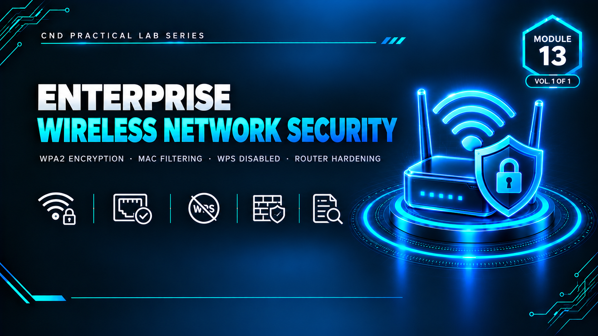

  

<h1>Module 13 — Enterprise Wireless Network Security</h1>
<h3>WPA2 Encryption, MAC Filtering &amp; Full Router Hardening (Linksys EA6200)</h3>

 

  

<a href="#lab-overview"><b>Overview</b></a> &nbsp;·&nbsp;
<a href="#hardening-summary"><b>Hardening Summary</b></a> &nbsp;·&nbsp;
<a href="#key-concepts-demonstrated"><b>Key Concepts</b></a> &nbsp;·&nbsp;
<a href="#full-report"><b>Full Report</b></a>

 

---

## Lab Overview

This module demonstrates wireless router security hardening using the **Linksys EA6200 Smart Wi-Fi** router simulator (`ui.linksys.com`, firmware `1.1.40.153121`). The original lab manual specifies the legacy WRT54G router; the EA6200 was used instead as it provides a more modern, comprehensive interface while covering all the same security objectives.

**Lab Objectives:**
- Configure WPA2 Personal encryption on both the 2.4 GHz and 5.0 GHz bands
- Enable MAC address filtering in whitelist mode
- Disable WPS (Wi-Fi Protected Setup) to remove a known attack vector
- Disable the Guest Network to prevent unauthorized access
- Change the router admin password to a strong credential
- Verify firewall settings (IPv4/IPv6 SPI, Internet filters)
- Disable DMZ and DDNS to minimize the attack surface
- Enable router logs for a security audit trail

> This lab was performed against the official Linksys UI demo simulator (`ui.linksys.com`) — a public, designated practice environment — not a live production router.

 

## Hardening Summary

<table>
<tr><th>Security Feature</th><th>Configuration Applied</th><th>Status</th></tr>
<tr><td>Wireless Encryption</td><td>WPA2 Personal (AES)</td><td>✅ Secured</td></tr>
<tr><td>2.4 GHz SSID</td><td>Renamed to <code>ENTERPRISE-SECURE</code></td><td>✅ Renamed</td></tr>
<tr><td>5.0 GHz SSID</td><td>Renamed to <code>ENTERPRISE-SECURE-2</code></td><td>✅ Renamed</td></tr>
<tr><td>Network Password</td><td>Changed from default</td><td>✅ Changed</td></tr>
<tr><td>Router Admin Password</td><td>Hardened to a strong unique credential, separate from the Wi-Fi password</td><td>✅ Hardened</td></tr>
<tr><td>MAC Filtering</td><td>Enabled — whitelist mode, only the lab VM's MAC address permitted</td><td>✅ Enabled</td></tr>
<tr><td>WPS (Wi-Fi Protected Setup)</td><td>Disabled</td><td>✅ Secured</td></tr>
<tr><td>Guest Network</td><td>Disabled</td><td>✅ Off</td></tr>
<tr><td>IPv4 SPI Firewall</td><td>Enabled</td><td>✅ On</td></tr>
<tr><td>IPv6 SPI Firewall</td><td>Enabled</td><td>✅ On</td></tr>
<tr><td>Filter Anonymous Internet Requests</td><td>Enabled</td><td>✅ On</td></tr>
<tr><td>Filter Ident (Port 113)</td><td>Enabled</td><td>✅ On</td></tr>
<tr><td>DMZ</td><td>Disabled</td><td>✅ Off</td></tr>
<tr><td>DDNS</td><td>Disabled</td><td>✅ Off</td></tr>
<tr><td>Router Logs</td><td>Enabled — authentication events captured (LAN IP, MAC, timestamp, result)</td><td>✅ On</td></tr>
</table>

 

## Key Concepts Demonstrated

<table>
<tr><td><b>WPA2 Personal (AES)</b></td><td>Strongest practical wireless encryption for personal/SMB use, replacing legacy WEP/WPA</td></tr>
<tr><td><b>MAC Filtering (Whitelist)</b></td><td>Only pre-approved device MAC addresses are permitted to associate with the network</td></tr>
<tr><td><b>WPS Disabled</b></td><td>Removes the PIN/button-based connection mechanism, a known brute-forceable attack vector</td></tr>
<tr><td><b>Guest Network Disabled</b></td><td>Eliminates a secondary, less-monitored access point into the network</td></tr>
<tr><td><b>Router Admin Password Changed</b></td><td>Prevents unauthorized access to the router's management interface itself</td></tr>
<tr><td><b>SPI Firewall (IPv4 + IPv6)</b></td><td>Stateful Packet Inspection examines incoming traffic on both IP versions and blocks unauthorized packets</td></tr>
<tr><td><b>Filter Anonymous Internet Requests</b></td><td>Prevents the router from responding to ping/port scans originating from the internet</td></tr>
<tr><td><b>DMZ Disabled</b></td><td>No device is exposed directly to the internet with no firewall protection</td></tr>
<tr><td><b>DDNS Disabled</b></td><td>No external hostname mapping, reducing the network's external visibility</td></tr>
<tr><td><b>Router Logs Enabled</b></td><td>Provides a security audit trail of every authentication attempt to the router</td></tr>
</table>

 

## Key Takeaways

- **Wireless hardening is multi-layered, not a single setting.** Encryption (WPA2), access control (MAC whitelist), attack-surface reduction (WPS/Guest/DMZ/DDNS disabled), and perimeter filtering (SPI firewall) were all applied together.
- **The router admin interface is itself an attack surface** — changing the router's management password is a distinct and equally important step from securing the Wi-Fi network itself.
- **Logging completes the control set.** Enabling router logs ensures hardening decisions can be verified against real authentication activity after the fact, not just assumed to be working.
- **A simulator is an appropriate, safe substitute** when the exact specified hardware isn't available — the EA6200 simulator covers every objective the lab manual's legacy router would have, without requiring physical equipment.

 

## Lab Environment

| | |
|---|---|
| **Router** | Linksys EA6200 — Smart Wi-Fi Dual-Band Router (simulator) |
| **Interface** | `ui.linksys.com` (official Linksys UI demo site) |
| **Firmware** | 1.1.40.153121 |
| **Scope** | Public designated demo/practice environment — not a live production router |

 

## Full Report

The complete 22-page report — including every configuration screen across Wireless, MAC Filtering, WPS, Connectivity, Guest Access, Troubleshooting/Logs, and Security (Firewall/DMZ/Apps & Gaming) — is available here:

📄 **[report.pdf](./report.pdf)**

 

## Disclaimer

This lab was conducted against the official Linksys UI demo simulator for educational purposes under the EC-Council CND curriculum. No live production router or real network was configured or affected. All credentials shown are demo-only values.

 

⬅ <a href="../"><b>Back to Main Repository</b></a>

