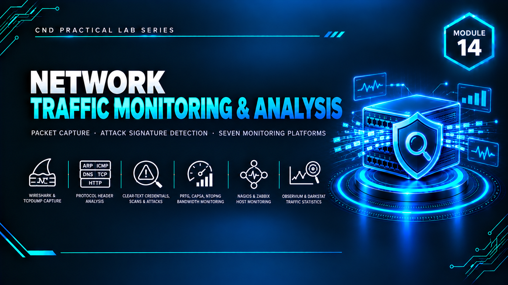

  

<h1>Module 14 — Network Traffic Monitoring &amp; Analysis</h1>
<h3>Packet Capture, Attack Detection &amp; Enterprise Monitoring Platforms</h3>

 

  

<a href="#lab-topology"><b>Topology</b></a> &nbsp;·&nbsp;
<a href="#packet-capture--attack-detection"><b>Packet Analysis</b></a> &nbsp;·&nbsp;
<a href="#enterprise-monitoring-platforms"><b>Monitoring Platforms</b></a> &nbsp;·&nbsp;
<a href="#key-takeaways"><b>Takeaways</b></a> &nbsp;·&nbsp;
<a href="#full-report"><b>Full Report</b></a>

 

---

## Executive Summary

Module 14 covers **network traffic monitoring and analysis** — capturing live traffic, identifying malicious activity at the packet level, and deploying enterprise-grade platforms for continuous visibility into network health and performance.

The module combines low-level packet analysis using **Wireshark** and **tcpdump**, a controlled demonstration of traffic-based attacks with **Cain & Abel** to show what an attacker on the wire can observe, and monitoring platforms (**PRTG**, **Zabbix**, plus additional tools such as Capsa, ntopng, Nagios, Observium and Darkstat) that turn raw traffic into dashboards, alerts and long-term trends. `[ADD: one sentence on what the overall lab proved]`

> All testing was performed in a fully isolated host-only / NAT virtual network with no connection to production systems. All credentials and IP addresses shown are disposable lab-only values.

 

## Lab Topology

`[ADD: one or two sentences describing the lab layout and which VMs generate, capture and monitor traffic.]`

<table>
<tr><th>VM / Device</th><th>Operating System</th><th>Role</th><th>IP Address</th></tr>
<tr><td>Monitoring Server</td><td><code>[ADD: Windows / Linux]</code></td><td><code>[ADD: Hosts PRTG / Zabbix]</code></td><td><code>[ADD: IP]</code></td></tr>
<tr><td>Attacker / Test Machine</td><td><code>[ADD: Windows / Kali]</code></td><td><code>[ADD: Generates test traffic]</code></td><td><code>[ADD: IP]</code></td></tr>
<tr><td>Target Host</td><td><code>[ADD: OS]</code></td><td><code>[ADD: Monitored endpoint]</code></td><td><code>[ADD: IP]</code></td></tr>
</table>

<table>
<tr><th>VMnet</th><th>Type</th><th>Subnet</th><th>Purpose</th></tr>
<tr><td><code>[ADD: VMnetX]</code></td><td><code>[Host-Only / NAT]</code></td><td><code>[ADD: subnet]</code></td><td><code>[ADD: purpose]</code></td></tr>
</table>

 

## Packet Capture & Attack Detection

Packet-level analysis and controlled attack observation.

<table>
<tr><th>Lab</th><th>Tool</th><th>Technique</th><th>Result</th></tr>
<tr><td><code>[ADD]</code></td><td><code>Wireshark</code></td><td>Live capture, display filters, TCP stream follow</td><td><code>[ADD: result]</code></td></tr>
<tr><td><code>[ADD]</code></td><td><code>tcpdump</code></td><td>Command-line capture and filtering</td><td><code>[ADD: result]</code></td></tr>
<tr><td><code>[ADD]</code></td><td><code>Cain & Abel</code></td><td>Controlled sniffing / ARP-based attack demonstration</td><td><code>[ADD: result]</code></td></tr>
</table>

 

## Enterprise Monitoring Platforms

Continuous monitoring, alerting and performance visibility.

<table>
<tr><th>Platform</th><th>Purpose</th><th>Configuration Performed</th><th>Result</th></tr>
<tr><td><code>PRTG</code></td><td>Sensor-based network monitoring</td><td><code>[ADD: sensors / devices added]</code></td><td><code>[ADD: result]</code></td></tr>
<tr><td><code>Zabbix</code></td><td>Agent-based monitoring and alerting</td><td><code>[ADD: hosts / triggers configured]</code></td><td><code>[ADD: result]</code></td></tr>
<tr><td><code>[Capsa / ntopng / Nagios / Observium / Darkstat]</code></td><td><code>[ADD: purpose]</code></td><td><code>[ADD]</code></td><td><code>[ADD: result]</code></td></tr>
</table>

 

## Key Takeaways

- **Packets don't lie.** Capturing traffic with Wireshark and tcpdump shows exactly what is — and isn't — protected on the wire; unencrypted protocols expose their content to anyone positioned on the network.
- **Understanding the attacker's view informs defense.** Observing what a tool like Cain & Abel can capture makes the case for encryption, segmentation and switch-level protections concrete.
- **Monitoring turns captures into operations.** Platforms such as PRTG and Zabbix convert point-in-time packet captures into continuous baselines, alerts and trends.
- `[ADD: one takeaway specific to your own findings]`

 

## Lab Environment

| | |
|---|---|
| **Hypervisor** | VMware Workstation |
| **Operating Systems** | `[ADD: e.g. Windows Server 2019 · Windows 10 · Kali Linux · Ubuntu]` |
| **Tools Used** | `Wireshark` `tcpdump` `Cain & Abel` `PRTG` `Zabbix` `Capsa` `ntopng` `Nagios` `Observium` `Darkstat` |
| **Scope** | Isolated lab only — zero production exposure |

 

## Full Report

The complete `[ADD: XX]`-page report — including every capture, filter, attack demonstration and monitoring-platform dashboard — is available here:

📄 **[NS-M14.pdf](./NS-M14.pdf)**

 

## Disclaimer

This lab was conducted in a private, isolated virtual environment built solely for educational purposes under the EC-Council CND curriculum. No real production systems, networks, or live targets were accessed or affected. All credentials, IP addresses, and configuration values shown are lab-only values with no validity outside this sandbox.

 

⬅ <a href="../"><b>Back to Main Repository</b></a>

