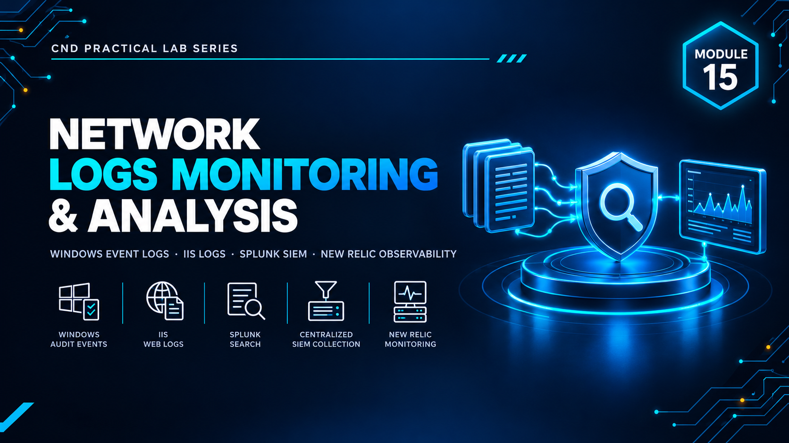

  

<h1>Module 15 — Network Logs Monitoring &amp; Analysis</h1>
<h3>Windows Event Auditing, IIS Logging &amp; Centralized SIEM with Splunk</h3>

 

  

<a href="#lab-topology"><b>Topology</b></a> &nbsp;·&nbsp;
<a href="#logging-pipeline"><b>Logging Pipeline</b></a> &nbsp;·&nbsp;
<a href="#siem--application-monitoring"><b>SIEM & Monitoring</b></a> &nbsp;·&nbsp;
<a href="#key-takeaways"><b>Takeaways</b></a> &nbsp;·&nbsp;
<a href="#full-report"><b>Full Report</b></a>

 

---

## Executive Summary

Module 15 focuses on **log monitoring and analysis** — generating the right telemetry on Windows systems, collecting it centrally, and using it to detect and investigate security-relevant activity.

The module configures **Windows event auditing** and **IIS web server logging** at the source, then forwards and analyzes that data in **Splunk Enterprise** as a centralized SIEM. **New Relic** is used to extend visibility into application and infrastructure performance monitoring. `[ADD: one sentence on what the overall lab proved]`

> All testing was performed in a fully isolated host-only / NAT virtual network with no connection to production systems. All credentials and IP addresses shown are disposable lab-only values.

 

## Lab Topology

`[ADD: one or two sentences describing which machines generate logs and which hosts the Splunk server.]`

<table>
<tr><th>VM / Device</th><th>Operating System</th><th>Role</th><th>IP Address</th></tr>
<tr><td>Splunk Server</td><td><code>[ADD: OS]</code></td><td><code>[ADD: Splunk Enterprise indexer / search head]</code></td><td><code>[ADD: IP]</code></td></tr>
<tr><td>Windows Server (IIS)</td><td><code>[ADD: Windows Server]</code></td><td><code>[ADD: Web server generating IIS logs]</code></td><td><code>[ADD: IP]</code></td></tr>
<tr><td>Windows Client</td><td><code>[ADD: Windows 10]</code></td><td><code>[ADD: Event auditing source]</code></td><td><code>[ADD: IP]</code></td></tr>
</table>

<table>
<tr><th>VMnet</th><th>Type</th><th>Subnet</th><th>Purpose</th></tr>
<tr><td><code>[ADD: VMnetX]</code></td><td><code>[Host-Only / NAT]</code></td><td><code>[ADD: subnet]</code></td><td><code>[ADD: purpose]</code></td></tr>
</table>

 

## Logging Pipeline

Telemetry generation at the source.

<table>
<tr><th>Lab</th><th>Configuration</th><th>Log Source</th><th>Result</th></tr>
<tr><td><code>[ADD]</code></td><td>Windows audit policy (logon, object access, policy change, etc.)</td><td>Windows Security Event Log</td><td><code>[ADD: event IDs observed]</code></td></tr>
<tr><td><code>[ADD]</code></td><td>IIS logging (fields, format, location)</td><td>IIS W3C logs</td><td><code>[ADD: result]</code></td></tr>
</table>

 

## SIEM & Application Monitoring

Central collection, search and alerting.

<table>
<tr><th>Platform</th><th>Purpose</th><th>Configuration Performed</th><th>Result</th></tr>
<tr><td><code>Splunk Enterprise</code></td><td>Centralized log ingestion, search and dashboards</td><td><code>[ADD: forwarder / inputs / searches / alerts]</code></td><td><code>[ADD: result]</code></td></tr>
<tr><td><code>New Relic</code></td><td>Application and infrastructure monitoring</td><td><code>[ADD: agent / dashboard configured]</code></td><td><code>[ADD: result]</code></td></tr>
</table>

 

## Key Takeaways

- **You can only detect what you log.** Audit policies and IIS logging must be deliberately enabled — default settings leave significant visibility gaps.
- **Centralization makes logs useful.** Splunk turns scattered per-host logs into one searchable, correlatable timeline.
- **Different tools answer different questions.** A SIEM is built for security events; an observability platform like New Relic is built for application behavior and performance.
- `[ADD: one takeaway specific to your own findings]`

 

## Lab Environment

| | |
|---|---|
| **Hypervisor** | VMware Workstation |
| **Operating Systems** | `[ADD: e.g. Windows Server 2019 · Windows 10]` |
| **Tools Used** | `Windows Event Auditing` `IIS Logging` `Splunk Enterprise` `New Relic` |
| **Scope** | Isolated lab only — zero production exposure |

 

## Full Report

The complete `[ADD: XX]`-page report — including every audit-policy setting, IIS log configuration, Splunk search and dashboard — is available here:

📄 **[NS-M15.pdf](./NS-M15.pdf)**

 

## Disclaimer

This lab was conducted in a private, isolated virtual environment built solely for educational purposes under the EC-Council CND curriculum. No real production systems, networks, or live targets were accessed or affected. All credentials, IP addresses, and configuration values shown are lab-only values with no validity outside this sandbox.

 

⬅ <a href="../"><b>Back to Main Repository</b></a>

