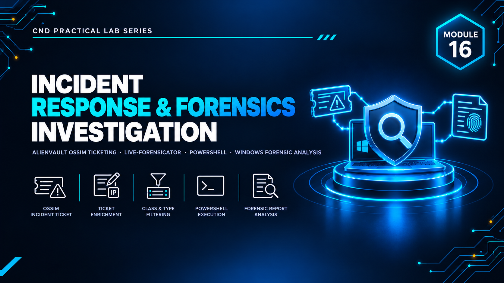

  

<h1>Module 16 — Incident Response &amp; Forensics Investigation</h1>
<h3>Ticket Lifecycle Management with OSSIM &amp; Live Windows Forensics</h3>

 

  

<a href="#lab-topology"><b>Topology</b></a> &nbsp;·&nbsp;
<a href="#incident-handling-ossim"><b>Incident Handling</b></a> &nbsp;·&nbsp;
<a href="#live-forensics-live-forensicator"><b>Live Forensics</b></a> &nbsp;·&nbsp;
<a href="#key-takeaways"><b>Takeaways</b></a> &nbsp;·&nbsp;
<a href="#full-report"><b>Full Report</b></a>

 

---

## Executive Summary

Module 16 covers the two halves of incident response: **managing an incident through its lifecycle** and **collecting forensic evidence from a live system**.

In the first part, **AlienVault OSSIM** is used to raise, track and close incident tickets. In the second, **Live-Forensicator** is run on a Windows host to collect volatile and system artifacts — processes, network connections, users, persistence and more — without taking the machine offline. `[ADD: one sentence on what the overall lab proved]`

> All testing was performed in a fully isolated host-only / NAT virtual network with no connection to production systems. All credentials and IP addresses shown are disposable lab-only values.

 

## Lab Topology

`[ADD: one or two sentences describing the OSSIM server and the Windows host investigated.]`

<table>
<tr><th>VM / Device</th><th>Operating System</th><th>Role</th><th>IP Address</th></tr>
<tr><td>OSSIM Server</td><td><code>[ADD: AlienVault OSSIM]</code></td><td><code>[ADD: SIEM / ticketing]</code></td><td><code>[ADD: IP]</code></td></tr>
<tr><td>Windows Host</td><td><code>[ADD: Windows 10 / Server]</code></td><td><code>[ADD: Live forensics target]</code></td><td><code>[ADD: IP]</code></td></tr>
</table>

<table>
<tr><th>VMnet</th><th>Type</th><th>Subnet</th><th>Purpose</th></tr>
<tr><td><code>[ADD: VMnetX]</code></td><td><code>[Host-Only / NAT]</code></td><td><code>[ADD: subnet]</code></td><td><code>[ADD: purpose]</code></td></tr>
</table>

 

## Incident Handling (OSSIM)

Ticket lifecycle from creation to closure.

<table>
<tr><th>Stage</th><th>Action Performed</th><th>Details</th><th>Result</th></tr>
<tr><td>Detection / Creation</td><td><code>[ADD]</code></td><td><code>[ADD: ticket title, priority, type]</code></td><td><code>[ADD]</code></td></tr>
<tr><td>Investigation / Update</td><td><code>[ADD]</code></td><td><code>[ADD]</code></td><td><code>[ADD]</code></td></tr>
<tr><td>Resolution / Closure</td><td><code>[ADD]</code></td><td><code>[ADD]</code></td><td><code>[ADD]</code></td></tr>
</table>

 

## Live Forensics (Live-Forensicator)

Evidence collection from a running Windows system.

<table>
<tr><th>Artifact Category</th><th>Examples Collected</th><th>Forensic Value</th><th>Findings</th></tr>
<tr><td>Processes & services</td><td><code>[ADD]</code></td><td>Identify malicious or unexpected execution</td><td><code>[ADD]</code></td></tr>
<tr><td>Network activity</td><td><code>[ADD]</code></td><td>Identify C2 / lateral movement</td><td><code>[ADD]</code></td></tr>
<tr><td>Users & persistence</td><td><code>[ADD]</code></td><td>Identify unauthorized access or footholds</td><td><code>[ADD]</code></td></tr>
</table>

 

## Key Takeaways

- **Incident response is a process, not a tool.** A consistent ticket lifecycle gives every incident an owner, a status and an audit trail.
- **Volatile evidence disappears.** Live forensics captures running processes and network state that would be lost on shutdown.
- **Documentation is part of the response.** Ticket records and collected artifacts together form the evidence trail for post-incident review.
- `[ADD: one takeaway specific to your own findings]`

 

## Lab Environment

| | |
|---|---|
| **Hypervisor** | VMware Workstation |
| **Operating Systems** | `[ADD: e.g. AlienVault OSSIM · Windows 10]` |
| **Tools Used** | `AlienVault OSSIM` `Live-Forensicator` |
| **Scope** | Isolated lab only — zero production exposure |

 

## Full Report

The complete `[ADD: XX]`-page report — including the full ticket lifecycle and every forensic artifact collected — is available here:

📄 **[NS-M16.pdf](./NS-M16.pdf)**

 

## Disclaimer

This lab was conducted in a private, isolated virtual environment built solely for educational purposes under the EC-Council CND curriculum. No real production systems, networks, or live targets were accessed or affected. All credentials, IP addresses, and configuration values shown are lab-only values with no validity outside this sandbox.

 

⬅ <a href="../"><b>Back to Main Repository</b></a>

