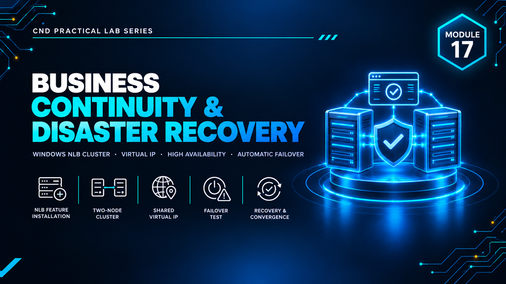

  

<h1>Module 17 — Business Continuity &amp; Disaster Recovery</h1>
<h3>Windows NLB Load-Balanced Failover Clustering &amp; Recovery Validation</h3>

 

  

<a href="#lab-topology"><b>Topology</b></a> &nbsp;·&nbsp;
<a href="#nlb-cluster-configuration"><b>NLB Cluster</b></a> &nbsp;·&nbsp;
<a href="#failover--recovery-validation"><b>Failover Validation</b></a> &nbsp;·&nbsp;
<a href="#key-takeaways"><b>Takeaways</b></a> &nbsp;·&nbsp;
<a href="#full-report"><b>Full Report</b></a>

 

---

## Executive Summary

Module 17 demonstrates **business continuity and disaster recovery** through a load-balanced, highly available service built with **Windows Network Load Balancing (NLB)**.

Multiple nodes are joined into an NLB cluster presenting a single virtual IP, then deliberately failed to prove that service continues when a node is lost and that the node can be recovered and rejoined. `[ADD: one sentence on what the overall lab proved]`

> All testing was performed in a fully isolated host-only / NAT virtual network with no connection to production systems. All credentials and IP addresses shown are disposable lab-only values.

 

## Lab Topology

`[ADD: one or two sentences describing the cluster nodes and the client used for testing.]`

<table>
<tr><th>VM / Device</th><th>Operating System</th><th>Role</th><th>IP Address</th></tr>
<tr><td>Node 1</td><td><code>[ADD: Windows Server 2019]</code></td><td><code>[ADD: NLB cluster member]</code></td><td><code>[ADD: IP]</code></td></tr>
<tr><td>Node 2</td><td><code>[ADD: Windows Server 2019]</code></td><td><code>[ADD: NLB cluster member]</code></td><td><code>[ADD: IP]</code></td></tr>
<tr><td>Cluster Virtual IP</td><td><code>[ADD: —]</code></td><td><code>[ADD: Single client-facing address]</code></td><td><code>[ADD: VIP]</code></td></tr>
<tr><td>Test Client</td><td><code>[ADD: Windows 10]</code></td><td><code>[ADD: Validates availability]</code></td><td><code>[ADD: IP]</code></td></tr>
</table>

<table>
<tr><th>VMnet</th><th>Type</th><th>Subnet</th><th>Purpose</th></tr>
<tr><td><code>[ADD: VMnetX]</code></td><td><code>[Host-Only / NAT]</code></td><td><code>[ADD: subnet]</code></td><td><code>[ADD: purpose]</code></td></tr>
</table>

 

## NLB Cluster Configuration

Building the load-balanced cluster.

<table>
<tr><th>Property</th><th>Value</th></tr>
<tr><td>Cluster operation mode</td><td><code>[ADD: Unicast / Multicast]</code></td></tr>
<tr><td>Cluster virtual IP</td><td><code>[ADD]</code></td></tr>
<tr><td>Port rules</td><td><code>[ADD]</code></td></tr>
<tr><td>Hosted service</td><td><code>[ADD: e.g. IIS website]</code></td></tr>
</table>

 

## Failover & Recovery Validation

Proving the cluster survives a node failure.

<table>
<tr><th>Test</th><th>Action</th><th>Expected</th><th>Observed</th></tr>
<tr><td>Normal operation</td><td>Access service via virtual IP</td><td>Requests served by cluster</td><td><code>[ADD]</code></td></tr>
<tr><td>Node failure</td><td>Stop / disable one node</td><td>Service continues on remaining node</td><td><code>[ADD]</code></td></tr>
<tr><td>Recovery</td><td>Restart node and rejoin</td><td>Node returns to load-balancing</td><td><code>[ADD]</code></td></tr>
</table>

 

## Key Takeaways

- **Availability is designed, not assumed.** A cluster only counts as resilient once a node has actually been failed and the service has stayed up.
- **A single virtual IP hides complexity from users.** Clients keep using one address while nodes come and go behind it.
- **Recovery must be tested as well as failover.** Rejoining a repaired node is part of the continuity plan.
- `[ADD: one takeaway specific to your own findings]`

 

## Lab Environment

| | |
|---|---|
| **Hypervisor** | VMware Workstation |
| **Operating Systems** | `[ADD: e.g. Windows Server 2019 · Windows 10]` |
| **Tools Used** | `Windows NLB` |
| **Scope** | Isolated lab only — zero production exposure |

 

## Full Report

The complete `[ADD: XX]`-page report — including cluster setup, port rules and every failover and recovery test — is available here:

📄 **[NS-M17.pdf](./NS-M17.pdf)**

 

## Disclaimer

This lab was conducted in a private, isolated virtual environment built solely for educational purposes under the EC-Council CND curriculum. No real production systems, networks, or live targets were accessed or affected. All credentials, IP addresses, and configuration values shown are lab-only values with no validity outside this sandbox.

 

⬅ <a href="../"><b>Back to Main Repository</b></a>

