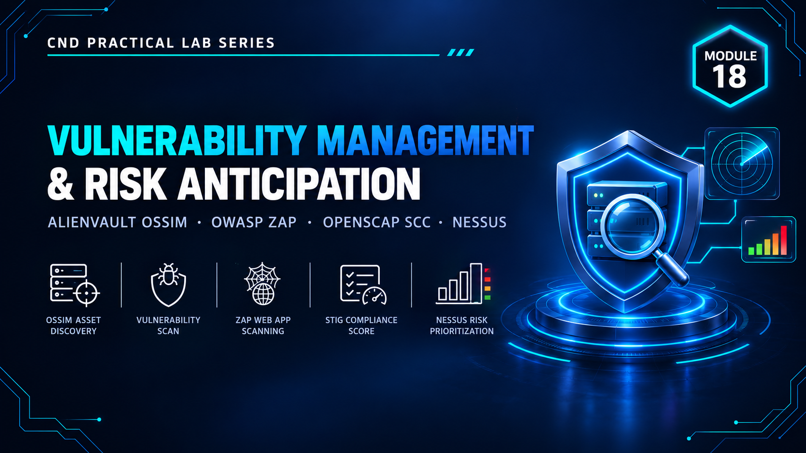

  

<h1>Module 18 — Vulnerability Management &amp; Risk Anticipation</h1>
<h3>Vulnerability Scanning, DAST Testing &amp; Compliance Auditing</h3>

 

  

<a href="#lab-topology"><b>Topology</b></a> &nbsp;·&nbsp;
<a href="#assessment-labs"><b>Assessment Labs</b></a> &nbsp;·&nbsp;
<a href="#findings-summary"><b>Findings</b></a> &nbsp;·&nbsp;
<a href="#key-takeaways"><b>Takeaways</b></a> &nbsp;·&nbsp;
<a href="#full-report"><b>Full Report</b></a>

 

---

## Executive Summary

Module 18 covers **vulnerability management** — systematically discovering weaknesses, rating their risk, and checking systems against compliance baselines before attackers find them.

Three complementary approaches are used: **Nessus** for network vulnerability scanning, **OWASP ZAP** for dynamic application security testing (DAST), and **OpenSCAP / SCC** for configuration-compliance auditing. `[ADD: one sentence on what the overall lab proved]`

> All testing was performed in a fully isolated host-only / NAT virtual network with no connection to production systems. All credentials and IP addresses shown are disposable lab-only values.

 

## Lab Topology

`[ADD: one or two sentences describing the scanner host and the targets assessed.]`

<table>
<tr><th>VM / Device</th><th>Operating System</th><th>Role</th><th>IP Address</th></tr>
<tr><td>Scanner</td><td><code>[ADD: OS]</code></td><td><code>[ADD: Nessus / ZAP host]</code></td><td><code>[ADD: IP]</code></td></tr>
<tr><td>Target 1</td><td><code>[ADD: OS]</code></td><td><code>[ADD: Scan target]</code></td><td><code>[ADD: IP]</code></td></tr>
<tr><td>Target 2</td><td><code>[ADD: OS]</code></td><td><code>[ADD: Compliance audit target]</code></td><td><code>[ADD: IP]</code></td></tr>
</table>

<table>
<tr><th>VMnet</th><th>Type</th><th>Subnet</th><th>Purpose</th></tr>
<tr><td><code>[ADD: VMnetX]</code></td><td><code>[Host-Only / NAT]</code></td><td><code>[ADD: subnet]</code></td><td><code>[ADD: purpose]</code></td></tr>
</table>

 

## Assessment Labs

Three layers of assessment.

<table>
<tr><th>Tool</th><th>Assessment Type</th><th>Target</th><th>Scope / Policy</th></tr>
<tr><td><code>Nessus</code></td><td>Network vulnerability scan</td><td><code>[ADD]</code></td><td><code>[ADD: scan template]</code></td></tr>
<tr><td><code>OWASP ZAP</code></td><td>DAST — web application scan</td><td><code>[ADD]</code></td><td><code>[ADD: spider / active scan]</code></td></tr>
<tr><td><code>OpenSCAP / SCC</code></td><td>Configuration compliance audit</td><td><code>[ADD]</code></td><td><code>[ADD: benchmark / profile]</code></td></tr>
</table>

 

## Findings Summary

Results by severity.

<table>
<tr><th>Tool</th><th>Critical</th><th>High</th><th>Medium</th><th>Low / Info</th></tr>
<tr><td><code>Nessus</code></td><td><code>[ADD]</code></td><td><code>[ADD]</code></td><td><code>[ADD]</code></td><td><code>[ADD]</code></td></tr>
<tr><td><code>OWASP ZAP</code></td><td><code>[ADD]</code></td><td><code>[ADD]</code></td><td><code>[ADD]</code></td><td><code>[ADD]</code></td></tr>
<tr><td><code>OpenSCAP / SCC</code></td><td><code>[ADD: pass / fail counts]</code></td><td>—</td><td>—</td><td>—</td></tr>
</table>

 

## Key Takeaways

- **Different scanners see different things.** Network scanning, application testing and compliance auditing each cover a different risk surface.
- **Findings need prioritization.** Severity ratings turn a long list into a remediation order.
- **Compliance is measurable.** Benchmark scans give a repeatable pass/fail baseline that can be re-run after remediation.
- `[ADD: one takeaway specific to your own findings]`

 

## Lab Environment

| | |
|---|---|
| **Hypervisor** | VMware Workstation |
| **Operating Systems** | `[ADD: e.g. Windows Server 2019 · Kali Linux · Ubuntu]` |
| **Tools Used** | `Nessus` `OWASP ZAP` `OpenSCAP` `SCC` |
| **Scope** | Isolated lab only — zero production exposure |

 

## Full Report

The complete `[ADD: XX]`-page report — including every scan configuration, finding and compliance report — is available here:

📄 **[NS-M18.pdf](./NS-M18.pdf)**

 

## Disclaimer

This lab was conducted in a private, isolated virtual environment built solely for educational purposes under the EC-Council CND curriculum. No real production systems, networks, or live targets were accessed or affected. All credentials, IP addresses, and configuration values shown are lab-only values with no validity outside this sandbox.

 

⬅ <a href="../"><b>Back to Main Repository</b></a>

