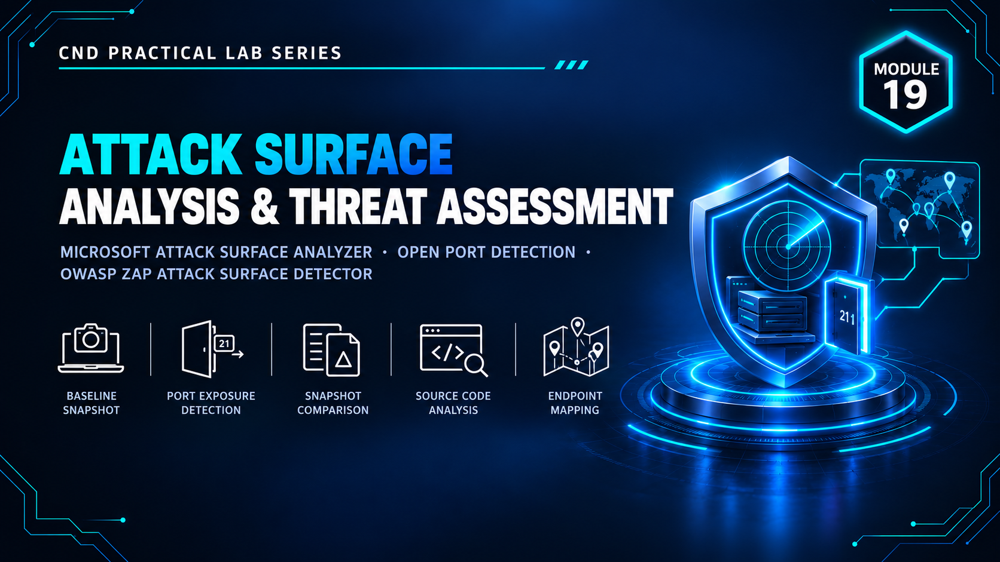

  

<h1>Module 19 — Attack Surface Analysis &amp; Threat Assessment</h1>
<h3>Operating System &amp; Web Application Attack Surface Mapping</h3>

 

  

<a href="#lab-topology"><b>Topology</b></a> &nbsp;·&nbsp;
<a href="#analysis-labs"><b>Analysis Labs</b></a> &nbsp;·&nbsp;
<a href="#key-takeaways"><b>Takeaways</b></a> &nbsp;·&nbsp;
<a href="#full-report"><b>Full Report</b></a>

 

---

## Executive Summary

Module 19 focuses on **attack surface analysis** — identifying everything on a system or application that an attacker could potentially interact with, and measuring how that surface changes.

**Microsoft Attack Surface Analyzer** is used to baseline a Windows operating system and detect changes after software or configuration is introduced, while the **ZAP Attack Surface Detector** maps the endpoints and parameters exposed by a web application. `[ADD: one sentence on what the overall lab proved]`

> All testing was performed in a fully isolated host-only / NAT virtual network with no connection to production systems. All credentials and IP addresses shown are disposable lab-only values.

 

## Lab Topology

`[ADD: one or two sentences describing the analyzed OS host and the web application target.]`

<table>
<tr><th>VM / Device</th><th>Operating System</th><th>Role</th><th>IP Address</th></tr>
<tr><td>Windows Host</td><td><code>[ADD: Windows 10 / Server]</code></td><td><code>[ADD: OS attack surface analysis]</code></td><td><code>[ADD: IP]</code></td></tr>
<tr><td>Web Application Host</td><td><code>[ADD: OS]</code></td><td><code>[ADD: Web attack surface analysis]</code></td><td><code>[ADD: IP]</code></td></tr>
</table>

<table>
<tr><th>VMnet</th><th>Type</th><th>Subnet</th><th>Purpose</th></tr>
<tr><td><code>[ADD: VMnetX]</code></td><td><code>[Host-Only / NAT]</code></td><td><code>[ADD: subnet]</code></td><td><code>[ADD: purpose]</code></td></tr>
</table>

 

## Analysis Labs

OS-level and application-level surface mapping.

<table>
<tr><th>Tool</th><th>Scope</th><th>Method</th><th>Result</th></tr>
<tr><td><code>MS Attack Surface Analyzer</code></td><td>Operating system</td><td>Baseline → change → comparison scan</td><td><code>[ADD: new services, ports, files, registry changes]</code></td></tr>
<tr><td><code>ZAP Attack Surface Detector</code></td><td>Web application</td><td>Endpoint and parameter discovery</td><td><code>[ADD: endpoints / parameters found]</code></td></tr>
</table>

 

## Key Takeaways

- **You can't defend what you haven't mapped.** Attack surface analysis gives a concrete inventory of exposure.
- **Change is where risk enters.** Comparing a baseline to a post-change scan shows exactly what an installation or configuration change added.
- **Applications have a surface too.** Exposed endpoints and parameters define where web attacks can begin.
- `[ADD: one takeaway specific to your own findings]`

 

## Lab Environment

| | |
|---|---|
| **Hypervisor** | VMware Workstation |
| **Operating Systems** | `[ADD: e.g. Windows 10 · Windows Server 2019]` |
| **Tools Used** | `MS Attack Surface Analyzer` `ZAP Attack Surface Detector` |
| **Scope** | Isolated lab only — zero production exposure |

 

## Full Report

The complete `[ADD: XX]`-page report — including every baseline, comparison scan and web endpoint map — is available here:

📄 **[NS-M19.pdf](./NS-M19.pdf)**

 

## Disclaimer

This lab was conducted in a private, isolated virtual environment built solely for educational purposes under the EC-Council CND curriculum. No real production systems, networks, or live targets were accessed or affected. All credentials, IP addresses, and configuration values shown are lab-only values with no validity outside this sandbox.

 

⬅ <a href="../"><b>Back to Main Repository</b></a>

