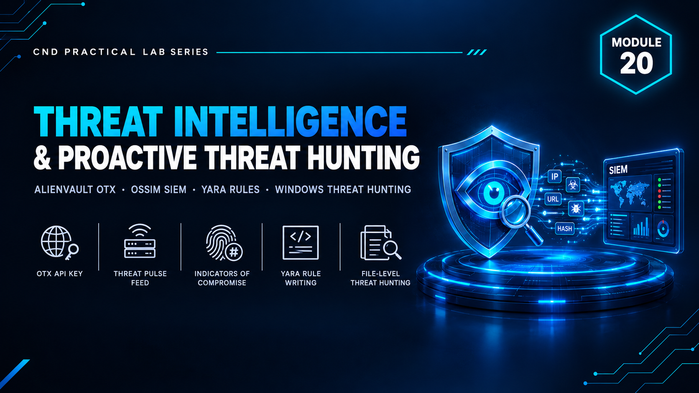

  

<h1>Module 20 — Threat Intelligence &amp; Proactive Threat Hunting</h1>
<h3>Threat Feed Integration &amp; YARA-Based IOC Hunting</h3>

 

  

<a href="#lab-topology"><b>Topology</b></a> &nbsp;·&nbsp;
<a href="#threat-intelligence--hunting"><b>Intelligence & Hunting</b></a> &nbsp;·&nbsp;
<a href="#key-takeaways"><b>Takeaways</b></a> &nbsp;·&nbsp;
<a href="#full-report"><b>Full Report</b></a>

 

---

## Executive Summary

Module 20 closes the portfolio with **threat intelligence and proactive threat hunting** — moving from reacting to alerts toward actively searching for known adversary indicators.

**AlienVault OTX** is used to consume community threat intelligence and pull indicators of compromise (IOCs), and **YARA** rules are used to hunt for those indicators and malware patterns across files on the lab system. `[ADD: one sentence on what the overall lab proved]`

> All testing was performed in a fully isolated host-only / NAT virtual network with no connection to production systems. All credentials and IP addresses shown are disposable lab-only values.

 

## Lab Topology

`[ADD: one or two sentences describing the hunting host and the data it was searched against.]`

<table>
<tr><th>VM / Device</th><th>Operating System</th><th>Role</th><th>IP Address</th></tr>
<tr><td>Analyst / Hunting Host</td><td><code>[ADD: OS]</code></td><td><code>[ADD: OTX integration and YARA scanning]</code></td><td><code>[ADD: IP]</code></td></tr>
<tr><td>Target Host</td><td><code>[ADD: OS]</code></td><td><code>[ADD: Contains test samples / artifacts]</code></td><td><code>[ADD: IP]</code></td></tr>
</table>

<table>
<tr><th>VMnet</th><th>Type</th><th>Subnet</th><th>Purpose</th></tr>
<tr><td><code>[ADD: VMnetX]</code></td><td><code>[Host-Only / NAT]</code></td><td><code>[ADD: subnet]</code></td><td><code>[ADD: purpose]</code></td></tr>
</table>

 

## Threat Intelligence & Hunting

From intelligence feed to hunt.

<table>
<tr><th>Stage</th><th>Tool</th><th>Action Performed</th><th>Result</th></tr>
<tr><td>Intelligence intake</td><td><code>AlienVault OTX</code></td><td><code>[ADD: pulses subscribed / IOCs retrieved]</code></td><td><code>[ADD]</code></td></tr>
<tr><td>Rule creation</td><td><code>YARA</code></td><td><code>[ADD: rule logic, strings / conditions]</code></td><td><code>[ADD]</code></td></tr>
<tr><td>Hunt execution</td><td><code>YARA</code></td><td><code>[ADD: scan scope and command]</code></td><td><code>[ADD: matches found]</code></td></tr>
</table>

 

## Key Takeaways

- **Intelligence is only useful when it's operationalized.** Feeds like OTX become valuable once their IOCs are turned into searches.
- **YARA turns knowledge into detection.** A rule encodes what a threat looks like so it can be found anywhere.
- **Hunting is proactive.** It looks for threats that haven't triggered an alert yet.
- `[ADD: one takeaway specific to your own findings]`

 

## Lab Environment

| | |
|---|---|
| **Hypervisor** | VMware Workstation |
| **Operating Systems** | `[ADD: e.g. Windows 10 · Kali Linux · Ubuntu]` |
| **Tools Used** | `AlienVault OTX` `YARA` |
| **Scope** | Isolated lab only — zero production exposure |

 

## Full Report

The complete `[ADD: XX]`-page report — including OTX integration, every YARA rule and the full hunt results — is available here:

📄 **[NS-M20.pdf](./NS-M20.pdf)**

 

## Disclaimer

This lab was conducted in a private, isolated virtual environment built solely for educational purposes under the EC-Council CND curriculum. No real production systems, networks, or live targets were accessed or affected. All credentials, IP addresses, and configuration values shown are lab-only values with no validity outside this sandbox.

 

⬅ <a href="../"><b>Back to Main Repository</b></a>

