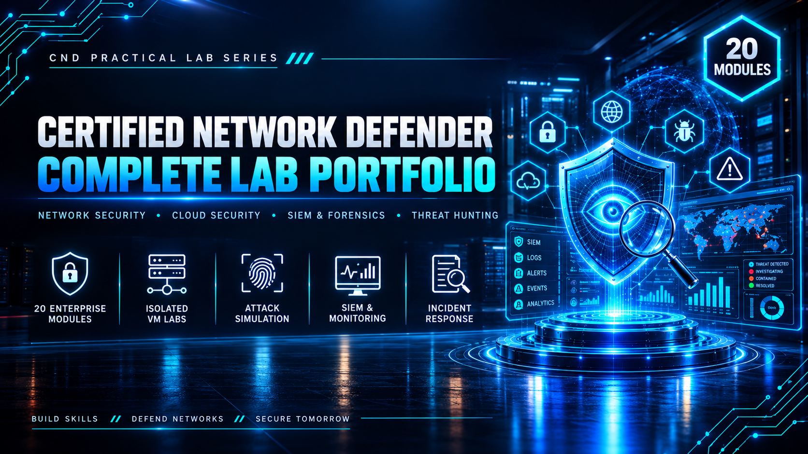

<div align="center">



<br><br>

<h1>Certified Network Defender</h1>
<h3>20 Enterprise Security Modules — Network, Cloud, Endpoint & SOC Operations</h3>

<br>


<br><br>

<a href="#modules"><b>Modules</b></a> &nbsp;·&nbsp;
<a href="#tools--technologies"><b>Tools</b></a> &nbsp;·&nbsp;
<a href="#repository-structure"><b>Structure</b></a> &nbsp;·&nbsp;
<a href="#license--usage-rights"><b>License</b></a> &nbsp;·&nbsp;
<a href="#contact"><b>Contact</b></a>

</div>

<br>

---

## Overview

This repository documents a complete, hands-on build of the **EC-Council Certified Network Defender (CND)** curriculum — 20 independent lab modules spanning network defense, endpoint hardening, cloud security, SIEM operations, forensics, and threat hunting.

Every module was built from the ground up in isolated VMware environments: network topology designed, systems deployed and hardened, controlled attacks launched against them, defensive tooling configured to detect and respond, and the entire process documented with full evidence.

Each module lives in its own directory — complete with a dedicated README, the full PDF report, and supporting screenshots.

> All labs were executed in fully isolated, host-only / NAT virtual networks with no connection to production systems. Any credentials, IP addresses, or domain names shown throughout this repository are disposable lab-only values with no validity outside the sandbox.

<br>

## Modules

<table>
<tr><th>#</th><th>Module</th><th>Focus</th><th>Core Tools</th></tr>

<tr><td>01</td><td><a href="./Module-01-Network-Segmentation/">Network Segmentation & Web App Attack Simulation</a></td><td>pfSense firewall, reconnaissance, SQL injection, stored XSS, brute force</td><td><code>pfSense</code> <code>Nmap</code> <code>Burp Suite</code> <code>Hydra</code></td></tr>

<tr><td>02</td><td><a href="./Module-02-Active-Directory/">Active Directory Infrastructure & Admin Security</a></td><td>AD DS, OU structure, GPO policies, RBAC, privileged access, endpoint monitoring</td><td><code>Active Directory</code> <code>GPO</code> <code>Lansweeper</code> <code>PAM360</code> <code>SpyAgent</code></td></tr>

<tr><td>03</td><td><a href="./Module-03-Technical-Network-Security/">Technical Network Security</a></td><td>Protocol hardening, PKI (AD CS), VPN, IDS, enhanced logging</td><td><code>AD CS</code> <code>SoftEther VPN</code> <code>Suricata</code> <code>Sysmon</code></td></tr>

<tr><td>04</td><td><a href="./Module-04-Perimeter-Network-Security/">Perimeter Network Security</a></td><td>Centralized gateway firewall rules, 8-scenario attack validation</td><td><code>pfSense</code> <code>Suricata</code></td></tr>

<tr><td>05</td><td><a href="./Module-05-Endpoint-Security/">Endpoint Security for Windows Systems</a></td><td>RBAC file shares, security baselines, SIEM, automated active response</td><td><code>Wazuh</code> <code>BatchPatch</code> <code>LGPO</code> <code>MITRE ATT&CK</code></td></tr>

<tr><td>06</td><td><a href="./Module-06-Linux-Hardening/">Linux System Hardening & Security Operations</a></td><td>SSH hardening, password policy, auditing, malware scanning, automation</td><td><code>Lynis</code> <code>rkhunter</code> <code>AuditD</code> <code>ClamAV</code></td></tr>

<tr><td>07</td><td><a href="./Module-07-Mobile-Device-Security/">Mobile Device Security</a></td><td>Mobile malware detection, enterprise device management</td><td><code>Emsisoft Mobile Security</code> <code>Bitdefender Central</code></td></tr>

<tr><td>08</td><td><a href="./Module-08-IoT-Security/">IoT Security</a></td><td>MQTT communication, traffic analysis, TLS encryption, custom PKI</td><td><code>Bevywise MQTT</code> <code>Wireshark</code> <code>OpenSSL</code></td></tr>

<tr><td>09</td><td><a href="./Module-09-Application-Security/">Administrative Application Security</a></td><td>Application whitelisting, sandboxing, web request filtering</td><td><code>AppLocker</code> <code>SRP</code> <code>Firejail</code> <code>Sandboxie-Plus</code></td></tr>

<tr><td>10</td><td><a href="./Module-10-Data-Security/">Data Security (3 Volumes)</a></td><td>Encryption at rest and in transit, secure backup, file and disk recovery</td><td><code>VeraCrypt</code> <code>SQL Server TDE</code> <code>PGP</code> <code>BitLocker</code> <code>EaseUS</code></td></tr>

<tr><td>11</td><td><a href="./Module-11-Virtual-Network-Security/">Enterprise Virtual Network Security</a></td><td>Container host hardening, SDN topology, controller SSL security</td><td><code>Docker-Bench-Security</code> <code>Mininet</code> <code>OpenFlow</code></td></tr>

<tr><td>12</td><td><a href="./Module-12-Cloud-Network-Security/">Enterprise Cloud Network Security</a></td><td>IAM, KMS encryption, NACL segmentation, EC2, Azure Entra ID</td><td><code>AWS (IAM/KMS/EC2)</code> <code>Microsoft Azure</code></td></tr>

<tr><td>13</td><td><a href="./Module-13-Wireless-Network-Security/">Enterprise Wireless Network Security</a></td><td>WPA2 encryption, MAC filtering, router hardening</td><td><code>Linksys EA6200</code></td></tr>

<tr><td>14</td><td><a href="./Module-14-Traffic-Monitoring/">Network Traffic Monitoring & Analysis</a></td><td>Packet capture, attack detection, enterprise monitoring platforms</td><td><code>Wireshark</code> <code>tcpdump</code> <code>Cain & Abel</code> <code>PRTG</code> <code>Zabbix</code></td></tr>

<tr><td>15</td><td><a href="./Module-15-Log-Monitoring/">Network Logs Monitoring & Analysis</a></td><td>Windows event auditing, IIS logging, centralized SIEM</td><td><code>Splunk Enterprise</code> <code>New Relic</code></td></tr>

<tr><td>16</td><td><a href="./Module-16-Incident-Response-Forensics/">Incident Response & Forensics Investigation</a></td><td>Ticket lifecycle management, live Windows forensics</td><td><code>AlienVault OSSIM</code> <code>Live-Forensicator</code></td></tr>

<tr><td>17</td><td><a href="./Module-17-Business-Continuity-DR/">Business Continuity & Disaster Recovery</a></td><td>Load-balanced failover clustering and recovery validation</td><td><code>Windows NLB</code></td></tr>

<tr><td>18</td><td><a href="./Module-18-Vulnerability-Management/">Vulnerability Management & Risk Anticipation</a></td><td>Vulnerability scanning, DAST testing, compliance auditing</td><td><code>OWASP ZAP</code> <code>OpenSCAP/SCC</code> <code>Nessus</code></td></tr>

<tr><td>19</td><td><a href="./Module-19-Attack-Surface-Analysis/">Attack Surface Analysis & Threat Assessment</a></td><td>OS and web application attack surface mapping</td><td><code>MS Attack Surface Analyzer</code> <code>ZAP Attack Surface Detector</code></td></tr>

<tr><td>20</td><td><a href="./Module-20-Threat-Intelligence-Hunting/">Threat Intelligence & Proactive Threat Hunting</a></td><td>Threat feed integration, YARA-based IOC hunting</td><td><code>AlienVault OTX</code> <code>YARA</code></td></tr>

</table>

<br>

## Tools & Technologies

<table>
<tr><td><b>Network & Perimeter</b></td><td><code>pfSense</code> <code>Smoothwall</code> <code>Windows Firewall</code> <code>Suricata IDS</code> <code>Windows NLB</code></td></tr>
<tr><td><b>Identity & Access</b></td><td><code>Active Directory</code> <code>GPO</code> <code>AWS IAM</code> <code>Microsoft Entra ID</code> <code>PAM360</code></td></tr>
<tr><td><b>Endpoint & Application</b></td><td><code>AppLocker</code> <code>SRP</code> <code>Firejail</code> <code>Sandboxie-Plus</code> <code>AuditD</code> <code>Sysmon</code> <code>ClamAV</code> <code>Lynis</code> <code>rkhunter</code></td></tr>
<tr><td><b>Encryption & PKI</b></td><td><code>VeraCrypt</code> <code>BitLocker</code> <code>AD CS</code> <code>OpenSSL</code> <code>PGP/Gpg4win</code> <code>SSL/TLS</code> <code>TDE</code> <code>Always Encrypted</code></td></tr>
<tr><td><b>Monitoring & SIEM</b></td><td><code>Wireshark</code> <code>tcpdump</code> <code>Splunk</code> <code>Wazuh</code> <code>Zabbix</code> <code>PRTG</code> <code>Capsa</code> <code>ntopng</code> <code>Nagios</code> <code>Observium</code> <code>Darkstat</code> <code>New Relic</code></td></tr>
<tr><td><b>Vulnerability & Threat Intel</b></td><td><code>AlienVault OSSIM</code> <code>AlienVault OTX</code> <code>OWASP ZAP</code> <code>OpenSCAP/SCC</code> <code>Nessus</code> <code>YARA</code> <code>MS Attack Surface Analyzer</code></td></tr>
<tr><td><b>Cloud & Virtualization</b></td><td><code>AWS (IAM/KMS/NACL/EC2)</code> <code>Microsoft Azure</code> <code>Docker</code> <code>Docker-Bench-Security</code> <code>Mininet/SDN</code></td></tr>
<tr><td><b>Offensive Tooling</b> <sub>(used defensively, in-lab)</sub></td><td><code>Nmap</code> <code>Burp Suite</code> <code>Hydra</code> <code>Cain & Abel</code></td></tr>
</table>

<br>

## Lab Environment

| | |
|---|---|
| **Hypervisor** | VMware Workstation |
| **Networking** | Isolated Host-Only / NAT VMnets, segmented per module |
| **Operating Systems** | Windows Server 2019 · Windows 10 · Kali Linux · Ubuntu |
| **Scope** | Every attack and defensive control targets only machines inside each lab topology — zero production exposure |


<br>

## Repository Structure
 
Each module is fully self-contained — its own README with a cover image and summary, the full PDF report, and a screenshot folder.
 
```
CND-Lab-Portfolio/
├── README.md
├── LICENSE
├── images/
│   └── banner.png
│
├── Module-01-Network-Segmentation/
│   ├── README.md
│   ├── report.pdf
│   └── images/
│       └── cover.png
│
├── Module-02-Active-Directory/
│   ├── README.md
│   ├── report.pdf
│   └── images/
│       └── cover.png
│
├── ...
│
├── Module-10-Data-Security/
│   ├── README.md
│   ├── Volume-1-Encryption-at-Rest.pdf
│   ├── Volume-2-Transit-Backup-Recovery.pdf
│   ├── Volume-3-Partition-Recovery-BitLocker.pdf
│   └── images/
│
├── ...
│
└── Module-20-Threat-Intelligence-Hunting/
    ├── README.md
    ├── report.pdf
    └── images/
        └── cover.png
```
 
<br>

## License & Usage Rights

**© 2026 Abdul Wahid. All Rights Reserved.**

Licensed under **[CC BY-NC-ND 4.0](./LICENSE)** — Attribution, NonCommercial, NoDerivatives.

| Permitted | Not Permitted |
|---|---|
| View, read, and reference this work | Redistribute or republish without credit |
| Share a link to this repository | Use any part of it commercially |
| Cite it in your own research/portfolio with attribution | Modify and redistribute as your own work |

For any use beyond this license, reach out via the contact details below.

<br>

## Disclaimer

All labs were conducted in private, isolated virtual environments built solely for educational purposes under the EC-Council CND curriculum. No real production systems, networks, or live targets were accessed or affected. Any credentials, IP addresses, or domain names shown throughout this repository are lab-only values with no validity outside this sandbox.

<br>

## Contact

<div align="center">

**Abdul Wahid**
Certified Network Defender (CND) Candidate — EC-Council

<br>

<a href="mailto:a.wahid7860668@gmail.com"></a>
<a href="https://www.linkedin.com/in/abdul-wahid022"></a>
<a href="https://github.com/abdul-wahid022"></a>

<br><br>

<sub>If this portfolio was useful to you, consider starring the repository.</sub>

</div>
